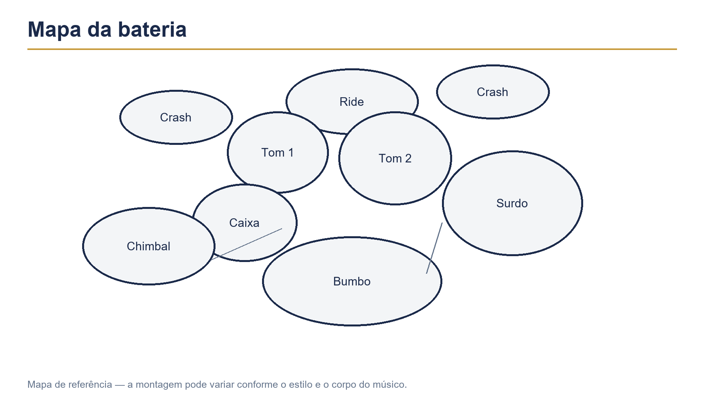

# Capítulo 1 — História e função da bateria



## Objetivos de aprendizagem

Ao concluir este capítulo, você será capaz de:

- explicar por que a bateria reúne funções que antes eram distribuídas entre vários percussionistas;
- reconhecer a relação entre pulso, forma, dinâmica e energia;
- diferenciar a função de um baterista, de um percussionista e de um músico de sessão;
- ouvir uma música identificando pelo menos o pulso, a condução, a caixa, o bumbo e as mudanças de seção;
- tocar uma célula simples mantendo o tempo e servindo à forma musical.

## Pré-requisitos

Nenhum conhecimento musical é necessário. Você pode estudar este capítulo em uma bateria acústica, eletrônica, compacta ou em uma superfície de prática silenciosa. Se ainda não tiver baquetas, faça os exercícios com palmas, batidas leves nas pernas ou apenas falando a contagem.

## A ideia central

A bateria não é apenas um conjunto de tambores. Ela é um sistema de funções: marca o tempo, organiza a subdivisão, sustenta a energia, articula transições e ajuda os demais músicos a saber onde estão na forma da música.

O instrumento moderno surgiu da combinação de práticas de percussão que antes exigiam mais de uma pessoa. Em bandas marciais, um músico podia tocar o bumbo, outro a caixa e outro os pratos. Com o desenvolvimento dos pedais e das ferragens, um único instrumentista passou a reunir essas funções. O kit tornou-se uma pequena orquestra rítmica coordenada por quatro membros.

Essa história explica uma característica essencial do instrumento: cada peça tem uma função, mas nenhuma peça trabalha isoladamente. O bumbo conversa com o baixo. A caixa reforça ou contrasta a pulsação. O chimbal ou o ride informa a subdivisão. Os tons e pratos ajudam a marcar deslocamentos, crescendos, viradas e finais.

## O papel da bateria no conjunto

Em uma banda, a bateria costuma cumprir quatro responsabilidades simultâneas:

1. **Tempo:** manter uma pulsação confiável, inclusive quando a música fica silenciosa ou complexa.
2. **Forma:** sinalizar introduções, versos, refrões, pontes, breaks e finais.
3. **Energia:** controlar intensidade, densidade, registro e dinâmica.
4. **Linguagem:** escolher um groove, uma condução e viradas que combinem com o estilo e com a intenção da música.

Manter o tempo não significa tocar muitas notas. Um groove simples, constante e bem colocado pode ser mais musical do que uma execução cheia de variações, mas instável. O baterista profissional aprende a decidir o que não tocar.

## Baterista, percussionista e músico de sessão

O percussionista normalmente trabalha com instrumentos cuja função pode ser melódica, textural ou rítmica: pandeiro, congas, timbales, tamborim, agogô, maracas e muitos outros. O baterista concentra no kit funções de sustentação do pulso, coordenação entre membros, condução e forma.

Há sobreposição entre as áreas. Um baterista pode estudar percussão, e um percussionista pode tocar bateria. A diferença principal está no papel assumido dentro do arranjo.

O músico de sessão precisa acrescentar outra camada de responsabilidade: interpretar rapidamente uma orientação, adaptar-se ao estilo da produção, respeitar a forma, tocar com consistência em várias tomadas e entregar uma parte que favoreça a gravação. O objetivo não é provar quantas ideias possui, mas oferecer a ideia certa para a música.

## O que ouvir antes de tocar

Escolha uma música curta ou uma base instrumental. Antes de pegar as baquetas, faça três escutas:

### Primeira escuta — forma

Não tente identificar tudo. Marque com a mão quando perceber mudanças importantes. Anote quantas seções você percebe: introdução, parte principal, refrão, ponte e final.

### Segunda escuta — pulso

Bata palmas apenas nos pulsos regulares. Se perder o tempo, pare de bater, continue contando internamente e retome no próximo início de compasso.

### Terceira escuta — funções

Tente localizar:

- o som grave que conversa com o baixo;
- o som agudo ou médio que marca respostas e acentos;
- a condução contínua no chimbal, ride ou outra superfície;
- as viradas e os momentos em que a bateria muda de densidade.

Não é necessário identificar o nome de cada peça. Primeiro reconheça o comportamento musical.

## Exercício 1 — mapa de escuta

**Andamento:** o andamento original da música ou uma base entre 60 e 80 BPM.  
**Subdivisão:** semínimas.  
**Contagem:** “1, 2, 3, 4”.  
**Membros:** voz e uma mão; depois os quatro membros, se possível.  
**Dinâmica:** volume confortável, sem bater forte.  
**Repetições:** três escutas completas ou três minutos.

Durante a música, preencha mentalmente esta sequência:

| Pergunta | Resposta a observar |
| --- | --- |
| Onde está o pulso? | regular, acelerando ou relaxando |
| Onde o bumbo apoia? | junto ao baixo, antes dele ou depois dele |
| Onde a caixa responde? | nos tempos fortes, fracos ou em síncopa |
| O que conduz? | chimbal, ride, prato, silêncio ou outra textura |
| O que muda na forma? | densidade, registro, dinâmica ou padrão |

**Critério para avançar:** conseguir descrever a forma e cantar ou falar o pulso sem depender da bateria gravada.

## Exercício 2 — pulso corporal

Sente-se com a coluna confortável. Fale “1, 2, 3, 4” em andamento constante. Bata a mão direita na perna nos quatro pulsos. Depois, acrescente uma batida da mão esquerda nos tempos 2 e 4.

**Andamento inicial:** 60 BPM.  
**Repetições:** quatro compassos por cinco vezes.  
**Variação iniciante:** use apenas a mão direita.  
**Variação intermediária:** mantenha a mão direita nos quatro pulsos e acrescente o pé direito no tempo 1.  
**Variação avançada:** mantenha o pulso, retire mentalmente o clique no tempo 4 e retome verificando se permaneceu estável.

O objetivo não é produzir volume. É perceber se o corpo consegue sustentar uma referência enquanto outra ação é adicionada.

## Exercício 3 — primeira célula no kit

Na bateria, toque uma célula simples:

```text
Contagem:  1   2   3   4
Chimbal:   x   x   x   x
Caixa:         O       O
Bumbo:     O       O
```

Toque o chimbal com a mão direita, a caixa com a mão esquerda e o bumbo com o pé direito. Mantenha o som baixo e regular.

**Andamento inicial:** 50–60 BPM.  
**Subdivisão:** semínimas.  
**Repetições:** oito compassos, três séries.  
**Critério para aumentar:** suba 5 BPM somente se conseguir três séries sem parar, sem apertar os ombros e sem perder a posição da caixa nos tempos 2 e 4.

Se a coordenação ainda não estiver pronta, faça cada camada separadamente: chimbal, depois caixa, depois bumbo. Em seguida, combine duas camadas antes de tentar as três.

## Aplicação musical

O groove deste capítulo é deliberadamente simples. Ele serve para observar três relações fundamentais:

- o bumbo cria uma base grave;
- a caixa organiza uma resposta reconhecível;
- a condução mantém a subdivisão exposta.

Toque oito compassos. Nos oito compassos seguintes, retire o bumbo do tempo 3, mas mantenha a contagem. Depois retorne ao padrão inicial. Essa pequena alteração ensina que variar não significa abandonar o pulso.

Em uma música real, a escolha entre tocar o padrão completo, reduzir a densidade ou deixar espaço depende do baixo, da voz, da harmonia e da forma. Escute o conjunto antes de decidir.

## Erros comuns e estratégias de correção

### Acelerar sem perceber

Toque com metrônomo e grave apenas 30 segundos. Compare o início e o final. Se o final estiver mais rápido, reduza o andamento e diminua a força dos golpes.

### Tocar forte demais

Faça a mesma célula em três níveis: baixo, médio e forte. O forte não deve ser um golpe descontrolado. Ombros levantados, punhos rígidos ou dor são sinais para parar e reorganizar o movimento.

### Perder a forma

Conte compassos em voz baixa e marque as seções com palavras simples: “intro”, “parte”, “refrão”, “ponte”. A bateria deve ajudar o conjunto a atravessar a forma, não apenas repetir um padrão.

### Confundir complexidade com musicalidade

Antes de acrescentar uma virada, toque a música inteira com o groove mais simples que funcionar. Se a parte já sustenta a música, qualquer variação deve ter uma razão clara.

## Desafio de consolidação

Escolha uma base de dois a quatro minutos. Faça uma gravação com três etapas:

1. toque apenas o pulso corporal durante os primeiros compassos;
2. entre com o groove básico sem fazer viradas;
3. marque uma mudança de seção com uma pausa curta e retorne ao groove.

Depois, responda:

- o andamento permaneceu estável?
- a caixa ficou consistente nos tempos 2 e 4?
- o bumbo conversou com a base?
- a entrada e o retorno ficaram claros?
- você tocou mais do que a música precisava?

## Checklist de domínio

- [ ] Consigo explicar as quatro funções principais da bateria.
- [ ] Consigo diferenciar bateria, percussão e atuação de músico de sessão.
- [ ] Consigo identificar o pulso de uma música.
- [ ] Consigo perceber mudanças de forma e densidade.
- [ ] Consigo tocar o groove básico por oito compassos.
- [ ] Consigo manter uma dinâmica confortável.
- [ ] Consigo gravar e avaliar uma execução curta.

## Rotina recomendada

Para uma sessão de 15 minutos:

- 3 minutos de escuta e mapa da forma;
- 3 minutos de pulso corporal;
- 5 minutos de groove básico;
- 2 minutos de variação com retirada do bumbo;
- 2 minutos de gravação e anotação.

Registre a data, o andamento, a base utilizada e uma observação objetiva. A primeira meta não é tocar rápido. É terminar a sessão sabendo exatamente o que ficou estável e o que precisa ser estudado novamente.
