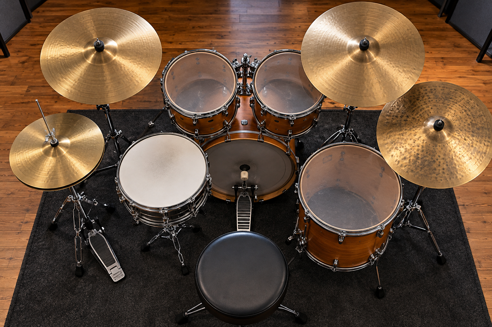

# Capítulo 2 — Componentes da bateria



## Objetivos de aprendizagem

Ao concluir este capítulo, você será capaz de:

- identificar os principais componentes de uma bateria acústica;
- explicar a função musical de cada peça;
- diferenciar tambores, pratos, ferragens, pedais e acessórios;
- reconhecer equivalências básicas em uma bateria eletrônica ou compacta;
- montar um mapa simples do kit antes de começar a tocar.

## Pré-requisitos

Leia o Capítulo 1 e faça o exercício de escuta do pulso. Não é necessário possuir uma bateria completa. Uma caixa, um pad, uma bateria eletrônica ou uma superfície silenciosa já permitem estudar boa parte dos conceitos.

## A ideia central

Conhecer a bateria não significa decorar nomes. Significa entender o que cada componente oferece ao arranjo: grave ou agudo, sustentação ou ataque, marcação ou textura, continuidade ou acento.

O kit padrão pode mudar de tamanho e configuração, mas suas funções permanecem reconhecíveis. Um pad eletrônico pode substituir uma caixa para fins de estudo; um prato pode ser representado por uma superfície de borracha; um pedal simples pode praticar a função do bumbo. A adaptação é válida quando preserva o objetivo musical do exercício.

## Tambores

### Bumbo

O bumbo é o tambor de registro mais grave do kit. É acionado normalmente pelo pedal de bumbo e conversa de perto com o contrabaixo. Pode marcar os tempos principais, reforçar síncopas, criar antecipações ou participar de frases mais densas.

O som do bumbo depende do tamanho, das peles, da afinação, do abafamento, do pedal, da força do pé e do ambiente. Um bumbo maior não obriga o músico a tocar sempre mais grave ou mais forte.

### Caixa

A caixa costuma ocupar a região central do kit. Sua esteira produz o som característico de ataque e vibração, mas pode ser desligada para obter uma resposta mais seca. Ela marca backbeats, articula ghost notes, conduz rudimentos, responde à voz e participa de viradas.

A caixa é também um laboratório técnico: nela estudamos rebote, acentos, dinâmica, rolls, flams e drags. A posição da caixa deve permitir que os braços relaxem e que as baquetas retornem sem esforço excessivo.

### Tons

Os tons oferecem registros diferentes para deslocamentos melódicos e viradas. Um kit pode ter dois tons, três ou mais. A ordem mais comum vai do tom mais agudo ao mais grave, aproximando-se do surdo.

Não é necessário usar todos os tons em toda virada. Escolha-os de acordo com a direção da frase, o registro desejado e o espaço disponível na música.

### Surdo

O surdo é um tambor grave apoiado em pernas ou estrutura própria. Ele pode ampliar viradas, criar respostas graves e ocupar uma função intermediária entre tom e bumbo. Em alguns estilos, o surdo também contribui para a sensação de movimento do groove.

## Pratos

### Chimbal

O chimbal é formado por dois pratos montados em oposição e controlados por um pedal. Pode ser tocado fechado, semiaberto, aberto, na borda ou com o pé. É uma das principais fontes de subdivisão do kit.

Um chimbal fechado pode sustentar colcheias regulares. Uma abertura curta pode marcar uma antecipação ou o fim de uma frase. O pedal permite produzir notas sem usar as mãos e desenvolver independência do pé esquerdo.

### Prato de condução

O ride oferece uma condução contínua com diferentes regiões: corpo, borda e cúpula. O corpo produz uma marcação mais definida; a cúpula pode destacar o pulso; a borda adiciona acento.

A escolha entre chimbal e ride muda a textura, a projeção e a sensação de espaço. O baterista deve ouvir se a condução está ajudando a música ou ocupando frequências demais.

### Pratos de ataque

Crash, splash, china e outros pratos de efeito são usados para acentos, entradas, transições e finais. Eles não precisam aparecer em todas as viradas. Um ataque bem colocado tem mais função do que uma sequência de pratos sem direção.

## Pedais e ferragens

### Pedal de bumbo

O pedal transforma o movimento do pé em ataque no bumbo. Ajustes de ângulo, tensão da mola, posição da batedora e distância em relação à pele alteram a resposta.

No início, procure uma regulagem que permita retornar o pé sem travar o tornozelo. A velocidade só deve aumentar depois que o movimento estiver silencioso, confortável e repetível.

### Pedal de chimbal

O pedal de chimbal controla a abertura dos pratos e permite tocar o chimbal com o pé. A pressão pode ser contínua ou alternada. O pé esquerdo também ajuda a manter o corpo equilibrado.

### Estantes e suportes

As estantes sustentam caixas e pratos. Devem ficar firmes, mas não excessivamente apertadas. Ajuste a altura e a inclinação para que o golpe não exija desvio desnecessário do punho.

### Banco

O banco é parte do instrumento. Uma altura inadequada afeta a coluna, os joelhos, o alcance dos braços e a pressão nos pedais. A regulagem será estudada detalhadamente no Capítulo 3, mas desde já o aluno deve evitar tocar apoiado em um banco instável ou baixo demais.

## Baquetas e acessórios

Baquetas variam em comprimento, diâmetro, peso, ponta e material. Baquetas mais pesadas podem produzir mais volume, mas também aumentam a exigência física. A escolha deve considerar o estilo, o instrumento, o ambiente e a capacidade de controle.

Entre os acessórios úteis estão metrônomo, abafadores, tapete, protetor auricular, chave de afinação, peças de reposição, bolsa, estante para partitura e dispositivo para gravação. Nenhum acessório substitui postura e escuta.

## Adaptações do kit

### Bateria eletrônica

Pads eletrônicos oferecem controle de volume e possibilidade de estudo com fones. A resposta depende da sensibilidade, da curva de dinâmica, do módulo e do tipo de pad. O aluno deve evitar assumir que a mesma força usada no pad produzirá a mesma resposta em uma bateria acústica.

### Bateria compacta

Kits compactos usam tambores menores, menos peças ou soluções de montagem reduzida. São úteis para apartamentos, estudo e transporte. O mapa de funções continua válido: condução, caixa, bumbo e registros de tom podem estar distribuídos de forma diferente.

### Prática silenciosa

Pads, almofadas e abafadores permitem estudar movimentos e coordenação. Eles não reproduzem completamente o som, o rebote ou a projeção de uma bateria acústica. Alterne, quando possível, a prática silenciosa com escuta, gravação e contato com um instrumento real.

## Exercício 1 — mapa do kit

Sente-se diante da bateria ou de um desenho do instrumento. Aponte cada componente e diga sua função, sem tocar.

**Tempo:** 3 minutos.  
**Membros:** voz e mãos apontando.  
**Repetições:** duas rodadas.  
**Critério de domínio:** identificar bumbo, caixa, chimbal, tons, surdo, ride, crash, pedais, banco e estantes sem consultar uma lista.

Depois, escolha uma música e responda: quais peças parecem estar conduzindo? Qual componente reforça o grave? Onde a bateria muda de registro?

## Exercício 2 — função sem volume

Fale “bumbo, caixa, condução” em ciclos de quatro tempos. Aponte para o componente correspondente ou toque muito suavemente uma representação dele.

```text
Contagem:  1   2   3   4
Função:    B   C   B   C
Condução:  x   x   x   x
```

**Andamento inicial:** 50 BPM.  
**Subdivisão:** semínimas.  
**Repetições:** oito compassos.  
**Variação:** mantenha a condução enquanto troca o bumbo para os tempos 1 e 3 e a caixa para 2 e 4.

O exercício não pretende ensinar um groove completo. Ele ensina a separar funções para depois combiná-las com clareza.

## Aplicação musical

Escolha uma base simples. Toque quatro compassos usando apenas chimbal e caixa. Nos quatro seguintes, acrescente o bumbo. Depois faça a mesma sequência substituindo o chimbal pelo ride.

Observe como a música muda mesmo quando a contagem não muda. A escolha do componente modifica timbre, espaço e energia.

## Erros comuns e correções

### Decorar nomes sem ouvir funções

Toque cada componente isoladamente e descreva o som: grave, médio, agudo, curto, sustentado, seco ou aberto.

### Ajustar tudo pela força

Antes de apertar parafusos ou aumentar a tensão, verifique posição, altura e ângulo. Regulagem é combinação de som, ergonomia e segurança.

### Usar todos os componentes ao mesmo tempo

Toque uma música usando apenas três elementos. Acrescente outro somente quando souber qual função ele cumpre.

### Confundir bateria eletrônica com bateria acústica

Estude a coordenação no eletrônico, mas confira dinâmica, rebote e projeção em uma bateria acústica sempre que possível.

## Desafio de consolidação

Crie três versões de oito compassos da mesma base:

1. somente chimbal, caixa e bumbo;
2. condução no ride e uma abertura curta de chimbal;
3. uma virada usando dois registros diferentes, retornando ao groove.

Grave as três versões e escreva quais componentes mudaram a sensação da música.

## Checklist de domínio

- [ ] Identifico os tambores principais.
- [ ] Identifico os pratos e suas funções.
- [ ] Sei localizar os dois pedais.
- [ ] Sei explicar o papel do banco, das estantes e das ferragens.
- [ ] Consigo adaptar o mapa para uma bateria eletrônica ou compacta.
- [ ] Consigo escolher um componente por função musical.
- [ ] Consigo tocar uma base sem preencher todos os espaços.

## Rotina recomendada

Para uma sessão de 20 minutos:

- 4 minutos nomeando e ouvindo os componentes;
- 4 minutos separando bumbo, caixa e condução;
- 6 minutos tocando duas configurações de groove;
- 4 minutos praticando em uma bateria eletrônica, compacta ou silenciosa;
- 2 minutos registrando o que mudou entre os instrumentos.

O objetivo é terminar sabendo não apenas onde cada peça está, mas por que ela está sendo usada.


