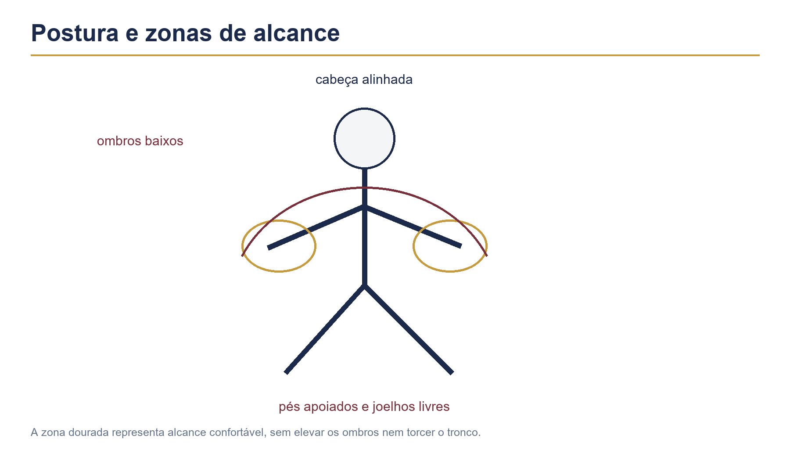

# Capítulo 5 — Postura e ergonomia

## Objetivos de aprendizagem

Ao concluir este capítulo, você será capaz de:

- sentar-se com estabilidade e liberdade para usar os quatro membros;
- organizar coluna, ombros, braços, mãos e pés sem rigidez excessiva;
- reconhecer sinais de tensão e fadiga durante o estudo;
- fazer um aquecimento curto antes de tocar;
- adaptar a postura à bateria acústica, eletrônica, compacta ou silenciosa;
- praticar com proteção auditiva e intervalos adequados.

## Pré-requisitos

Tenha uma configuração básica montada conforme o Capítulo 3. O capítulo pode ser estudado sentado no banco, mesmo sem tocar. Se houver dor persistente, dormência, formigamento ou perda de força, interrompa a prática e procure avaliação profissional.

## A ideia central

Postura não é uma pose imóvel. É uma organização dinâmica que permite respirar, ouvir, mover-se e retornar ao centro do corpo depois de cada golpe.

O baterista precisa de estabilidade suficiente para não perder o equilíbrio e liberdade suficiente para não travar os movimentos. Uma postura eficiente não elimina todo esforço, mas distribui o esforço entre as articulações e evita que uma pequena tensão se transforme em compensação constante.

## O centro do corpo

Sente-se no banco sem apoiar todo o peso em uma única parte. Mantenha os pés disponíveis para os pedais e permita que a bacia permaneça equilibrada. A coluna pode manter suas curvas naturais; não é necessário endurecê-la nem curvá-la excessivamente.

Os ombros devem ficar baixos e soltos. O peito não precisa ser projetado para frente. Respire sem prender o ar, especialmente durante exercícios lentos ou difíceis.

Faça um teste: sente-se, feche os olhos e inspire lentamente. Se a respiração ficar presa quando você prepara um golpe, reduza a força e observe onde o corpo está compensando.

## Cabeça, visão e escuta

Mantenha a cabeça alinhada com o tronco. Inclinar-se continuamente para olhar a caixa ou uma partitura pode criar tensão no pescoço. Posicione o material de estudo na altura necessária para consultar sem abandonar o equilíbrio.

A visão ajuda, mas não deve substituir a escuta. Aprenda a perceber a posição dos componentes pelo alcance e pelo som. Isso permite tocar com mais segurança em ambientes diferentes e reduz movimentos de correção.

## Braços, cotovelos e mãos

Os cotovelos devem permanecer livres, sem ficar colados ao corpo nem abertos em excesso. O antebraço deve conduzir a baqueta com movimento econômico. Punhos rígidos dificultam o rebote; dedos apertados reduzem a capacidade de mudar dinâmica.

A mão deve segurar a baqueta com firmeza suficiente para não perdê-la e liberdade suficiente para permitir o retorno. O ponto de equilíbrio da baqueta será estudado no próximo capítulo, mas já é possível evitar o erro de esmagar o cabo.

## Pés e pernas

Os pés devem alcançar os pedais sem que os joelhos se desloquem exageradamente. Mantenha as pernas disponíveis para movimentos pequenos e regulares. Evite apoiar o calcanhar de forma que o tornozelo fique travado por longos períodos.

O pé esquerdo pode controlar o chimbal ou ajudar no equilíbrio. O pé direito controla o bumbo. A distribuição do peso muda conforme a técnica, mas nenhum pé deve precisar compensar uma montagem instável.

## Aquecimento de cinco minutos

Antes de praticar, faça uma preparação simples:

1. respire profundamente três vezes, sem elevar os ombros;
2. mova pescoço e ombros lentamente, sem forçar amplitude;
3. abra e feche as mãos sem apertar;
4. faça círculos pequenos com os tornozelos;
5. toque alternado na caixa ou pad em volume muito baixo;
6. aumente gradualmente a amplitude somente se o movimento continuar confortável.

O aquecimento não deve causar dor. Ele serve para perceber o estado do corpo e preparar a atenção.

## Proteção auditiva

Baterias acústicas podem produzir níveis sonoros altos, principalmente em salas pequenas. Use protetores auriculares adequados ou fones de proteção que reduzam o volume sem eliminar completamente a percepção musical.

Não aumente o volume de uma bateria eletrônica ou de uma base para compensar um ambiente barulhento. Faça pausas e permita que os ouvidos se recuperem. Zumbido, sensação de ouvido tampado ou desconforto depois de tocar são sinais para reduzir a exposição e buscar orientação.

## Exercício 1 — postura neutra

Sente-se sem tocar e faça uma verificação corporal:

- os dois pés alcançam os pedais?
- a bacia está equilibrada?
- os ombros estão livres?
- os cotovelos conseguem se mover?
- a respiração está natural?
- você consegue olhar para a caixa sem curvar o pescoço?

**Duração:** um minuto.  
**Repetições:** três vezes antes de tocar.  
**Critério de domínio:** identificar pelo menos um ajuste necessário e corrigi-lo sem mudar toda a configuração do kit.

## Exercício 2 — golpes silenciosos

Toque alternado na caixa ou pad, com a baqueta retornando à mesma altura. Faça oito notas e descanse oito tempos.

**Andamento inicial:** 50 BPM.  
**Subdivisão:** semínimas; depois colcheias.  
**Dinâmica:** baixa.  
**Repetições:** seis ciclos.  
**Membros:** mão direita e esquerda alternadas.  
**Critério para aumentar:** a respiração permanece livre, os ombros não sobem e o som mantém volume semelhante.

Se a mão apertar a baqueta, pare e sacuda os dedos suavemente. Recomece com menos força.

## Exercício 3 — quatro membros sem tensão

Use o groove básico estudado no Capítulo 1. Toque apenas quatro compassos e descanse quatro compassos. Durante o descanso, mantenha a postura e observe se o corpo retorna ao centro.

**Andamento inicial:** 50–60 BPM.  
**Repetições:** cinco ciclos.  
**Dinâmica:** baixa para média.  
**Foco:** equilíbrio entre mãos, pé direito e pé esquerdo.

Não tente corrigir uma nota perdida fazendo o golpe seguinte mais forte. Preserve o pulso e retome a organização.

## Aplicação musical

Escolha uma base com andamento confortável e toque por dois minutos. A cada 30 segundos, observe apenas um item: respiração, ombros, mãos e pés.

O objetivo não é ficar pensando no corpo durante toda a música. É desenvolver verificações rápidas que possam ser usadas quando surgir fadiga, aumento de velocidade ou mudança de dinâmica.

## Erros comuns e correções

### Tocar com os ombros elevados

Toque mais baixo e faça uma expiração longa. Se o ombro voltar a subir, reduza o andamento. A velocidade não deve ser construída sobre tensão.

### Inclinar-se para alcançar os pratos

Aproxime ou abaixe o prato. Teste o retorno à caixa. Se o tronco precisar acompanhar cada golpe, a distância está grande demais.

### Prender a respiração

Fale a contagem em volume baixo ou expire no golpe. Depois mantenha a respiração silenciosa, mas contínua.

### Confundir relaxamento com falta de controle

Relaxar não significa deixar o corpo sem organização. Mantenha o centro estável e permita que mãos e pés façam movimentos menores.

### Ignorar dor persistente

Desconforto passageiro por esforço novo pode exigir descanso, mas dor persistente, dormência e formigamento não devem ser tratados como parte normal do estudo. Pare e procure avaliação.

## Desafio de consolidação

Faça uma sessão de dez minutos dividida em quatro blocos:

1. dois minutos de aquecimento;
2. três minutos de toque alternado em volume baixo;
3. três minutos de groove básico;
4. dois minutos de gravação e autoavaliação.

Na gravação, não avalie somente o som. Observe se você levanta os ombros, prende a respiração, perde o apoio dos pés ou se afasta da caixa.

## Checklist de domínio

- [ ] Sento com equilíbrio no banco.
- [ ] Consigo respirar sem prender o ar durante o exercício.
- [ ] Mantenho ombros e mãos sem tensão desnecessária.
- [ ] Alcanço os componentes sem inclinar o tronco excessivamente.
- [ ] Faço um aquecimento curto antes de tocar.
- [ ] Sei reconhecer sinais de fadiga ou dor.
- [ ] Uso proteção auditiva adequada.
- [ ] Consigo tocar quatro membros em andamento confortável.

## Rotina recomendada

Para uma sessão de 20 minutos:

- 5 minutos de aquecimento e postura;
- 4 minutos de golpes silenciosos;
- 6 minutos de groove com pausas;
- 3 minutos de base musical;
- 2 minutos de registro corporal e auditivo.

Registre não apenas o BPM. Anote onde surgiu tensão, qual ajuste ajudou e quanto tempo você conseguiu tocar com respiração e som estáveis.
