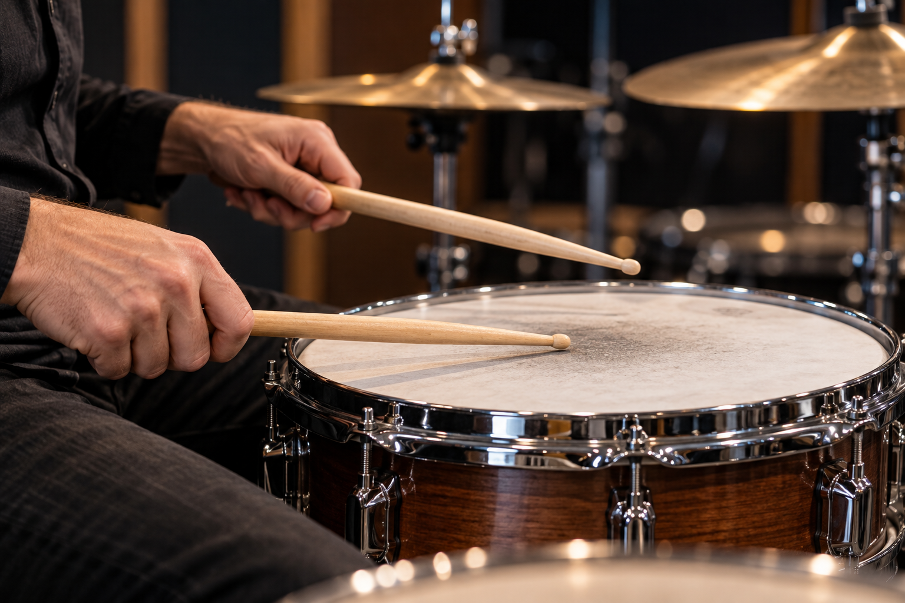

# Capítulo 6 — Pegadas de baqueta



## Objetivos de aprendizagem

Ao concluir este capítulo, você será capaz de:

- segurar a baqueta com controle e sem apertar excessivamente;
- diferenciar matched grip e traditional grip;
- reconhecer as características das abordagens German, French e American;
- escolher uma pegada inicial adequada ao exercício e ao próprio corpo;
- alternar entre controle, rebote, acento e dinâmica baixa;
- identificar quando uma pegada está produzindo tensão ou perda de som.

## Pré-requisitos

Estude o Capítulo 5 e faça o aquecimento curto. Tenha um par de baquetas de tamanho confortável ou dois objetos leves de comprimento semelhante. Não comece treinando velocidade; primeiro observe equilíbrio, respiração e retorno da baqueta.

## A ideia central

Pegada é uma relação móvel entre dedos, polegar, punho e antebraço. Não é uma posição congelada. A baqueta precisa permanecer segura durante o golpe, mas livre o bastante para retornar e mudar de dinâmica.

Não existe uma única pegada correta para todos os bateristas. Há princípios comuns: evitar esmagar o cabo, manter o punho disponível, permitir rebote, adaptar a rotação ao som desejado e interromper quando surgir dor persistente.

## Ponto de equilíbrio

Segure a baqueta aproximadamente no primeiro terço a partir da parte traseira, procurando o ponto em que ela pode oscilar com liberdade. O polegar e o indicador formam o controle principal, enquanto os demais dedos acompanham o movimento.

Faça um teste sem tocar: solte a pressão dos dedos restantes e mova a baqueta com o punho. Se ela escapar imediatamente, falta controle. Se não conseguir mover nada sem deslocar todo o antebraço, há excesso de tensão.

## Matched grip

Na matched grip, as duas mãos seguram as baquetas com uma relação semelhante. É uma abordagem comum para iniciantes porque facilita a simetria, a transferência de exercícios e a compreensão dos movimentos.

Matched grip não significa que as duas mãos precisam ser cópias perfeitas. A mão direita e a esquerda podem cumprir funções diferentes e desenvolver ajustes próprios conforme o som, o prato, a caixa e o estilo.

### German grip

Na abordagem German, as palmas tendem a ficar mais voltadas para baixo e o movimento utiliza bastante o punho. É útil para golpes fortes, controle de caixa e situações em que a baqueta precisa retornar de forma previsível.

**Vantagens:** sensação de estabilidade, boa referência para acentos e facilidade inicial para movimentos verticais.  
**Limitações:** pode gerar tensão se o aluno endurecer o antebraço ou tentar tocar tudo com o punho.

### French grip

Na abordagem French, os polegares tendem a ficar mais voltados para cima. A rotação dos dedos participa mais do controle, o que pode facilitar movimentos rápidos, articulação e deslocamentos em pratos.

**Vantagens:** leveza, precisão de dedos e adaptação a conduções.  
**Limitações:** pode perder apoio em golpes muito fortes se o aluno não integrar dedos, punho e antebraço.

### American grip

A abordagem American fica entre German e French. A palma não aponta completamente para baixo nem para o lado. É uma posição versátil para alternar entre caixa, tons e pratos.

**Vantagens:** equilíbrio entre força, controle e mobilidade.  
**Limitações:** por ser intermediária, pode parecer indefinida se o aluno não perceber qual articulação está comandando o movimento.

Esses nomes são referências, não caixas rígidas. Um baterista pode mudar a rotação da mão durante uma mesma frase.

## Traditional grip

Na traditional grip, a baqueta da mão esquerda passa por baixo da mão, apoiando-se na região entre polegar e indicador e sendo controlada pelos dedos e pela rotação do antebraço. A mão direita pode usar uma matched grip.

Essa pegada tem origem em práticas de caixa de bandas marciais, em que o tambor era carregado inclinado. Ela é usada por bateristas de jazz, bandas marciais e outros contextos, mas não é obrigatória para tocar estilos específicos.

**Vantagens:** permite uma relação particular com a caixa inclinada, facilita certas inflexões e oferece uma linguagem tradicional.  
**Limitações:** exige mais tempo de adaptação entre as mãos e pode gerar torção se for forçada em uma posição desconfortável.

Se você estudar traditional grip, ajuste a caixa para que o punho esquerdo permaneça livre. Não copie a inclinação de um instrumento de marcha se ela produzir dor.

## Como escolher uma abordagem

Comece pela pergunta musical e corporal:

- preciso de golpes baixos e controle de rebote?
- preciso tocar condução por muito tempo?
- minha mão está livre ou comprimida?
- consigo produzir três níveis de dinâmica?
- consigo alternar sem perder o pulso?

Para muitos iniciantes, American ou uma matched grip confortável oferece uma entrada simples. Isso não impede estudar German, French ou traditional depois. O melhor sistema é aquele que permite aprender o exercício sem tensão e produzir o som pedido.

## Exercício 1 — teste de equilíbrio

Segure a baqueta pelo ponto de equilíbrio e faça oito movimentos pequenos no ar. Depois toque oito notas leves na caixa ou pad.

**Andamento:** 50 BPM.  
**Subdivisão:** semínimas.  
**Repetições:** quatro ciclos por mão.  
**Dinâmica:** baixa.  
**Critério:** o som deve permanecer presente sem que a mão aperte a baqueta no retorno.

Faça o exercício com uma matched grip confortável. Depois mude apenas a rotação da mão e observe o que se altera. Não procure uma posição perfeita; procure perceber a relação entre liberdade e controle.

## Exercício 2 — tap e acento

Toque quatro notas baixas e uma nota acentuada:

```text
Contagem:  1 e 2 e 3 e 4 e
Notas:     t t t T t t t T
```

**Andamento inicial:** 50–60 BPM.  
**Subdivisão:** colcheias.  
**Membros:** mão direita por uma série, esquerda por outra, depois alternadas.  
**Repetições:** quatro compassos por configuração.  
**Critério para aumentar:** o tap permanece baixo e o acento não trava o punho.

O acento deve vir de uma mudança de altura e energia, não de apertar a baqueta no último instante.

## Exercício 3 — comparação de pegadas

Escolha uma matched grip confortável. Toque o padrão anterior e registre o som. Depois faça uma pequena variação para German, French ou American, sem forçar a anatomia. Se estudar traditional grip, use apenas a mão esquerda e mantenha a caixa em posição confortável.

Compare:

- clareza do acento;
- volume do tap;
- rebote;
- tensão no polegar;
- liberdade do antebraço;
- capacidade de retornar ao pulso.

O objetivo é observar, não declarar uma técnica vencedora.

## Aplicação musical

Use o padrão de quatro taps e um acento como uma camada de condução. Toque-o na caixa em volume baixo enquanto mantém o pé direito nos tempos 1 e 3. Depois transfira a mão para o chimbal, mantendo a mesma contagem.

A pegada deve mudar conforme a superfície. Uma posição confortável para a caixa pode não ser a melhor para a condução no prato. Aprenda a adaptar a rotação sem perder a estabilidade do corpo.

## Erros comuns e correções

### Apertar entre polegar e indicador

Reduza a pressão e deixe os dedos restantes acompanhar a baqueta. Faça oito notas leves e sacuda a mão no intervalo.

### Usar somente o punho

O punho é importante, mas a amplitude pode envolver dedos e antebraço. Pratique taps pequenos e observe se a mão consegue variar o volume.

### Confundir acento com golpe duro

Eleve a baqueta um pouco mais e deixe-a retornar. Se o som ficar agressivo ou o ombro subir, diminua a amplitude.

### Copiar traditional grip sem adaptar a caixa

Ajuste o instrumento ao corpo. Não torça o punho para reproduzir uma fotografia.

### Trocar de técnica a cada minuto

Escolha uma abordagem por sessão, registre o que observou e dê tempo para o corpo aprender. Comparações rápidas demais produzem mais confusão do que informação.

## Sinais de alerta

Pare ou reduza o exercício se aparecer dor aguda, dormência, formigamento, perda de força ou sensação de travamento. Fadiga leve pode indicar necessidade de pausa; dor persistente exige avaliação profissional.

## Desafio de consolidação

Grave quatro tomadas de 30 segundos:

1. matched grip confortável, taps baixos;
2. matched grip com acentos;
3. condução no chimbal com a mesma contagem;
4. uma abordagem alternativa escolhida com cuidado.

Avalie qual tomada apresenta melhor combinação de som, estabilidade, dinâmica e conforto. Não escolha apenas a que produz mais volume.

## Checklist de domínio

- [ ] Consigo localizar o ponto de equilíbrio da baqueta.
- [ ] Seguro sem esmagar o cabo.
- [ ] Consigo produzir taps e acentos diferentes.
- [ ] Sei diferenciar matched grip e traditional grip.
- [ ] Reconheço German, French e American grip.
- [ ] Consigo adaptar a rotação entre caixa e chimbal.
- [ ] Sei reconhecer tensão e sinais de alerta.
- [ ] Consigo escolher uma pegada por critério musical e corporal.

## Rotina recomendada

Para uma sessão de 20 minutos:

- 3 minutos de aquecimento das mãos;
- 5 minutos de equilíbrio e taps;
- 5 minutos de acentos;
- 4 minutos de comparação entre duas abordagens;
- 3 minutos de gravação e registro.

Durante as próximas semanas, não transforme a escolha da pegada em disputa. O objetivo é ampliar seus recursos sem perder o princípio principal: controle, som, relaxamento e musicalidade.


