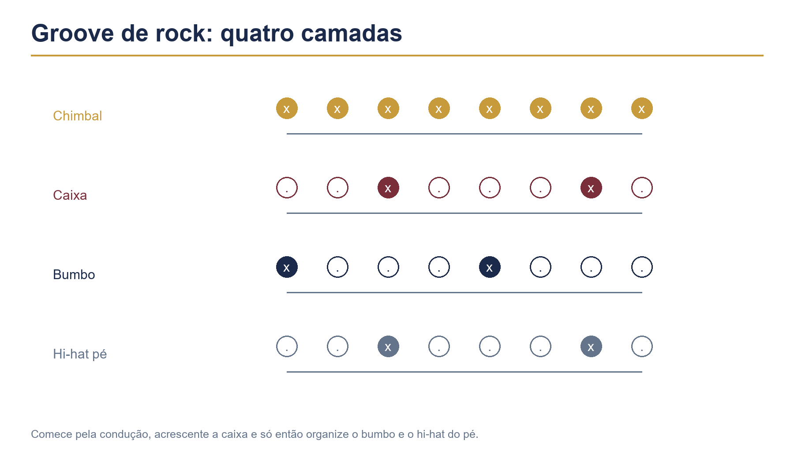

# Capítulo 18 — Groove básico de rock



## Objetivos de aprendizagem

Ao concluir este capítulo, você será capaz de:

- tocar o groove básico de rock em andamento estável;
- manter chimbal em colcheias, caixa nos tempos 2 e 4 e bumbo nos tempos principais;
- variar o bumbo sem perder o pulso;
- usar abertura de chimbal com controle;
- equilibrar dinâmica entre condução, caixa e bumbo;
- tocar o groove com uma base musical e sustentar a forma.

## Pré-requisitos

Estude os Capítulos 8, 11, 12 e 17. Você deve conseguir coordenar os quatro membros em andamento lento e manter a contagem durante pausas e variações simples.

## A ideia central

O groove básico de rock é uma escola de consistência. Ele não depende de muitas notas. Depende de uma relação estável entre bumbo, caixa e condução.

Em uma forma comum de 4/4, o bumbo apoia os tempos 1 e 3, a caixa responde nos tempos 2 e 4 e o chimbal organiza colcheias. Essa estrutura pode parecer simples, mas precisa sobreviver a mudanças de andamento, dinâmica, forma e interação com baixo e voz.

## Padrão fundamental

```text
Contagem:  1 e 2 e 3 e 4 e
Chimbal:   x x x x x x x x
Caixa:         O       O
Bumbo:     O       O
```

Toque oito compassos sem variar. O objetivo é sentir o ciclo de quatro tempos, não completar uma prova de velocidade.

**Andamento inicial:** 60 BPM.  
**Dinâmica:** chimbal médio-baixo, caixa média, bumbo médio.  
**Repetições:** três séries de oito compassos.  
**Critério:** não acelerar, não perder a caixa e manter o som do chimbal regular.

## Construção por camadas

### Chimbal

Toque colcheias e conte “1 e 2 e 3 e 4 e”. A mão deve permanecer pequena e econômica.

### Caixa

Mantenha o chimbal e acrescente caixa nos tempos 2 e 4. O backbeat deve ser consistente sem necessariamente ser o som mais forte de toda a bateria.

### Bumbo

Acrescente o bumbo nos tempos 1 e 3. Se o pulso dos pés desorganizar as mãos, volte a praticar chimbal e bumbo separadamente.

## Exercício 1 — rock em três andamentos

Toque o groove por oito compassos em 60, 70 e 80 BPM.

**Repetições:** três séries por andamento.  
**Descanso:** 30 segundos entre séries.  
**Critério para subir:** caixa nos tempos 2 e 4, chimbal uniforme e bumbo sem atraso ou antecipação.

Grave o andamento mais alto e o mais baixo. Compare se a dinâmica e a postura permaneceram iguais.

## Variações de bumbo

Mantenha a caixa nos tempos 2 e 4 e experimente:

### Variação A — apoio no tempo 3

```text
Bumbo:     O       O
```

### Variação B — antecipação no “e” do 2

```text
Contagem:  1 e 2 e 3 e 4 e
Bumbo:     O     O   O
```

### Variação C — preparação do tempo 4

```text
Contagem:  1 e 2 e 3 e 4 e
Bumbo:     O       O     O
```

Toque cada variação por quatro compassos e retorne ao padrão original. A mudança deve ser pequena o bastante para manter a identidade do groove.

## Exercício 2 — chamada e resposta do bumbo

Toque dois compassos do padrão e dois compassos de uma variação. O chimbal e a caixa permanecem constantes.

**Andamento:** 60–70 BPM.  
**Repetições:** seis ciclos.  
**Foco:** mudar o bumbo sem deixar que a mão direita acompanhe a alteração.

Se a condução variar involuntariamente, reduza o volume do chimbal e fale a contagem.

## Abertura de chimbal

Uma abertura curta pode acontecer no “e” de um tempo e ser fechada logo depois. Ela cria uma mudança de textura, não uma nota extra obrigatória.

```text
Contagem:  1 e 2 e 3 e 4 e
Chimbal:   x x x O x x x x
Caixa:         O       O
Bumbo:     O       O
```

Comece abrindo no “e” do 1 e fechando no tempo 2. Depois experimente o “e” do 4 como preparação para o compasso seguinte.

**Andamento:** 50–60 BPM.  
**Repetições:** quatro compassos por posição.  
**Critério:** a abertura é curta, controlada e não interrompe a caixa.

## Ride e variação de condução

Transfira o chimbal para o ride sem mudar bumbo e caixa. Escute como o groove fica mais aberto e projetado. Depois toque o ride no corpo e na cúpula em compassos alternados.

A condução não é um ornamento separado do groove. Ela muda a textura e deve acompanhar a seção da música.

## Dinâmica

Faça três versões:

1. verso: condução baixa, caixa média e bumbo controlado;
2. refrão: condução média, caixa mais presente e bumbo firme;
3. ponte: condução reduzida e mais espaço.

Não aumente tudo ao mesmo tempo. A dinâmica surge da relação entre camadas, não apenas do volume absoluto.

## Aplicação musical

Escolha uma base de rock ou pop sem bateria. Conte quatro compassos e entre com o groove fundamental. Toque oito compassos, mude para uma variação de bumbo por oito e retorne ao padrão inicial.

Marque a forma com palavras: entrada, parte, refrão, retorno. O objetivo é tocar para a música, não repetir um padrão sem ouvir o conjunto.

## Exercício 3 — groove e virada de um tempo

Toque sete compassos de groove. No último tempo do oitavo compasso, faça quatro single strokes na caixa e retorne ao groove no tempo 1.

**Andamento:** 60 BPM.  
**Repetições:** seis ciclos.  
**Foco:** a virada deve ocupar apenas o espaço planejado e não antecipar o próximo compasso.

Depois substitua os single strokes por dois golpes na caixa e dois no tom. Use a versão que melhor combina com a base.

## Erros comuns e correções

### Tocar o chimbal mais forte que a caixa

Reduza a altura da mão direita e escute o backbeat. A condução deve sustentar, não cobrir.

### Bumbo atrasado

Pratique bumbo e metrônomo sem as mãos. Depois acrescente apenas o chimbal em semínimas.

### Abertura longa demais

Use menos pressão no pedal e feche imediatamente. Grave a abertura para saber quanto tempo o prato realmente permanece aberto.

### Variar antes de estabilizar

Toque pelo menos oito compassos sem variação. Uma variação deve ter função de forma, não esconder a falta de consistência.

### Ignorar o baixo

Ouça a linha grave e experimente colocar o bumbo junto dela ou deixar espaço. O groove de rock é uma conversa, não um exercício isolado.

## Diagnóstico rápido

Grave 30 segundos e observe:

- a caixa está igualmente posicionada nos tempos 2 e 4?
- o chimbal mantém colcheias regulares?
- o bumbo muda de lugar sem puxar as mãos?
- o corpo permanece relaxado?
- a variação ajuda a forma?

Escolha um item para corrigir em uma nova tomada.

## Desafio de consolidação

Crie uma estrutura de 32 compassos:

1. oito compassos de groove básico;
2. oito compassos com variação de bumbo;
3. oito compassos no ride com dinâmica maior;
4. sete compassos de groove e uma virada de um tempo;
5. retorno ao tempo 1 com crash e bumbo.

Grave duas versões, uma econômica e outra mais densa. Compare qual serve melhor à forma e à base.

## Checklist de domínio

- [ ] Toco o groove básico em andamento estável.
- [ ] Mantenho chimbal, caixa e bumbo independentes.
- [ ] Consigo variar o bumbo sem acelerar.
- [ ] Uso abertura de chimbal curta e controlada.
- [ ] Transfiro a condução para o ride.
- [ ] Organizo dinâmica por seção.
- [ ] Consigo fazer uma virada de um tempo.
- [ ] Escuto e acompanho a relação com o baixo.

## Rotina recomendada

Para uma sessão de 20 minutos:

- 4 minutos de camadas;
- 4 minutos de groove fundamental;
- 4 minutos de variações de bumbo;
- 3 minutos de chimbal aberto e ride;
- 3 minutos de aplicação em base;
- 2 minutos de gravação e registro.

O groove básico de rock é uma fundação, não um limite. Quando o tempo, a dinâmica e a relação entre os membros estão estáveis, você pode acrescentar variações sem perder a função principal: fazer a música avançar.
