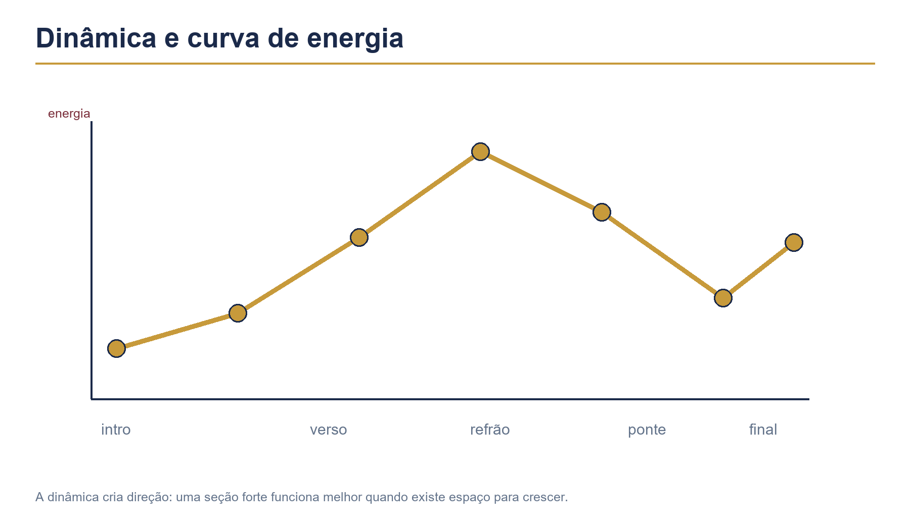

# Capítulo 25 — Dinâmica



## Objetivos de aprendizagem

Ao concluir este capítulo, você será capaz de:

- diferenciar volume, acento, densidade e energia;
- tocar piano, forte, crescendo e decrescendo com controle;
- equilibrar condução, caixa, bumbo e pratos;
- usar ghost notes e acentos para criar camadas;
- mudar a dinâmica conforme a seção da música;
- gravar e avaliar mudanças de intensidade sem perder o tempo.

## Pré-requisitos

Estude os Capítulos 7, 18, 20, 21 e 24. Você deve controlar golpes fundamentais, grooves, conduções e viradas simples.

## A ideia central

Dinâmica é a organização da energia sonora ao longo do tempo. Ela inclui volume, densidade, registro, duração, articulação, espaço e timbre.

Tocar forte não é apenas bater mais. Tocar piano não é desaparecer. O baterista precisa fazer cada nível permanecer audível e funcional dentro do conjunto.

## Quatro níveis iniciais

Use quatro referências práticas:

- **piano:** baixo, próximo e controlado;
- **mezzo:** presença média, sem excesso;
- **forte:** ataque claro e maior projeção;
- **fortíssimo:** reservado para momentos realmente intensos.

Esses níveis não são números fixos. O ambiente, a sala, o instrumento e a música mudam o resultado.

## Exercício 1 — uma nota, quatro volumes

Toque uma semínima na caixa em quatro níveis, descansando um compasso entre eles.

```text
Compasso 1: piano
Compasso 2: mezzo
Compasso 3: forte
Compasso 4: forte com controle
```

**Andamento:** 50 BPM.  
**Repetições:** quatro ciclos.  
**Foco:** manter a mesma posição no tempo e alterar somente a intensidade.

Grave a sequência. Se os quatro níveis parecerem iguais, ajuste a altura da baqueta e o ponto de contato antes de aumentar a força.

## Dinâmica por camadas

Um groove pode ter condução baixa, caixa média e bumbo controlado. A mesma parte pode ganhar energia quando a condução fica mais aberta, a caixa recebe mais presença e o bumbo se alinha ao baixo.

Não aumente todos os membros na mesma proporção. Decida qual camada precisa conduzir a mudança.

## Exercício 2 — groove em três níveis

Toque o groove de rock em três versões:

1. chimbal piano, caixa mezzo e bumbo piano;
2. chimbal mezzo, caixa forte e bumbo mezzo;
3. ride ou chimbal aberto, caixa forte e bumbo forte.

**Andamento:** 60 BPM.  
**Duração:** oito compassos por versão.  
**Critério:** o pulso e a forma permanecem iguais enquanto a energia muda.

## Crescendo

Crescendo é um aumento gradual. Pode ser criado por volume, quantidade de notas, mudança de condução, abertura de prato ou combinação desses elementos.

Faça um crescendo de quatro compassos:

```text
Compasso 1: chimbal fechado, groove simples
Compasso 2: chimbal mais presente
Compasso 3: caixa e bumbo mais firmes
Compasso 4: condução aberta e chegada
```

Não transforme o primeiro compasso em médio-alto. O crescimento precisa ter espaço para acontecer.

## Decrescendo

Decrescendo reduz a energia sem perder o pulso. Diminua a altura das baquetas, feche a condução, retire notas e escolha superfícies mais curtas.

Pratique uma virada que começa forte e termina baixa, retornando ao groove piano. O último ataque precisa continuar no tempo correto.

## Exercício 3 — crescendo e decrescendo

Toque oito compassos:

1. dois compassos baixos;
2. dois compassos em crescimento;
3. dois compassos fortes;
4. dois compassos em redução.

**Andamento:** 55–60 BPM.  
**Repetições:** quatro vezes.  
**Foco:** a dinâmica muda de forma gradual, sem acelerar.

## Acentos

Acento é uma nota que recebe destaque relativo. Ele pode ser produzido por altura, articulação, superfície ou combinação. Um acento bem colocado não precisa ser o som mais forte de toda a música.

Pratique acentos na condução e mantenha a caixa em nível diferente. Depois transfira o acento para o bumbo ou para um prato.

## Ghost notes e contraste

Ghost notes criam contraste quando ficam abaixo do backbeat. Elas ajudam a preencher uma seção sem aumentar seu volume geral.

Toque um compasso com caixa nos tempos 2 e 4. No seguinte, acrescente duas notas baixas. O objetivo é aumentar textura sem transformar o compasso em forte.

## Exercício 4 — dinâmica independente

Mantenha chimbal baixo e altere somente a caixa:

1. backbeat baixo;
2. backbeat médio;
3. backbeat forte;
4. retorno ao baixo.

Depois faça o contrário: mantenha a caixa e altere a condução.

**Andamento:** 50 BPM.  
**Repetições:** quatro ciclos.  
**Critério:** uma camada muda enquanto as outras permanecem estáveis.

## Dinâmica por seção

Uma organização comum pode ser:

- **introdução:** pouco volume e espaço;
- **verso:** groove controlado para apoiar a voz;
- **pré-refrão:** crescimento gradual;
- **refrão:** maior presença e condução mais aberta;
- **ponte:** contraste ou redução;
- **final:** decisão entre sustentação, corte ou diminuição.

Não trate essa sequência como regra. Escute o arranjo e escolha a energia que a música pede.

## Exercício 5 — arranjo dinâmico

Escolha uma base com pelo menos três seções e escreva uma palavra para cada trecho: baixo, médio, crescendo, forte, reduzido ou final.

Toque a música inteira sem viradas na primeira rodada. Na segunda, acrescente apenas as mudanças de condução e dinâmica. Na terceira, adicione viradas curtas.

Essa ordem evita que a virada tente carregar sozinha a energia do arranjo.

## Dinâmica e gravação

Microfones, compressão e ambiente podem alterar a percepção de volume. Grave sem tentar corrigir tudo depois. Compare as tomadas em volume de reprodução semelhante.

Pergunte:

- a mudança é audível sem depender de aumentar o volume do arquivo?
- a caixa permanece clara?
- o bumbo continua definido?
- os pratos cobrem o restante?
- o crescendo tem etapas ou acontece de repente?

## Aplicação musical

Escolha uma música e toque três versões:

1. toda em dinâmica média;
2. com contraste entre verso e refrão;
3. com mais espaço e menos notas.

Compare qual versão deixa a voz e o baixo mais claros. A dinâmica da bateria deve favorecer a música inteira.

## Erros comuns e correções

### Tocar tudo forte

Reduza a altura das baquetas e retire notas. Forte só funciona quando existe contraste.

### Tocar piano sem som definido

Aproxime o movimento, mas mantenha precisão no contato. Uma nota baixa ainda precisa ser audível.

### Crescer de uma vez

Divida o crescimento em etapas de volume, densidade e timbre. Grave quatro compassos para ouvir a progressão.

### Usar prato para toda mudança

Experimente mudar condução, bumbo, caixa, espaço e registro. Prato é apenas uma das possibilidades.

### Confundir dinâmica com velocidade

Aumentar notas pode aumentar energia, mas não substitui controle de volume. Pratique o mesmo padrão em diferentes níveis.

## Diagnóstico rápido

Grave uma frase em piano, mezzo e forte. Verifique:

- a diferença de volume é clara?
- o pulso permanece igual?
- a postura muda quando você cresce?
- o som forte fica áspero ou descontrolado?
- o som baixo desaparece?

Escolha um ajuste técnico e um ajuste musical para a próxima tomada.

## Desafio de consolidação

Crie um arranjo de 24 compassos com:

1. quatro compassos em piano;
2. quatro em mezzo;
3. quatro em crescendo;
4. quatro em forte;
5. quatro em decrescendo;
6. quatro com final escolhido.

Grave e marque onde a energia mudou. Depois toque uma segunda versão retirando metade das notas, mas mantendo a mesma curva dinâmica.

## Checklist de domínio

- [ ] Consigo tocar quatro níveis de intensidade.
- [ ] Mantenho o pulso ao mudar volume.
- [ ] Faço crescendo gradual.
- [ ] Faço decrescendo sem perder definição.
- [ ] Controlo acentos relativos.
- [ ] Uso ghost notes como contraste.
- [ ] Organizo dinâmica por seção.
- [ ] Avalio dinâmica em gravação.

## Rotina recomendada

Para uma sessão de 20 minutos:

- 4 minutos de uma nota em quatro volumes;
- 4 minutos de groove em níveis diferentes;
- 4 minutos de crescendo e decrescendo;
- 3 minutos de dinâmica independente;
- 3 minutos de aplicação em música;
- 2 minutos de gravação e registro.

Dinâmica é a capacidade de fazer a bateria respirar. O baterista completo não toca sempre alto ou sempre baixo; escolhe a quantidade de energia que permite à música comunicar melhor.
