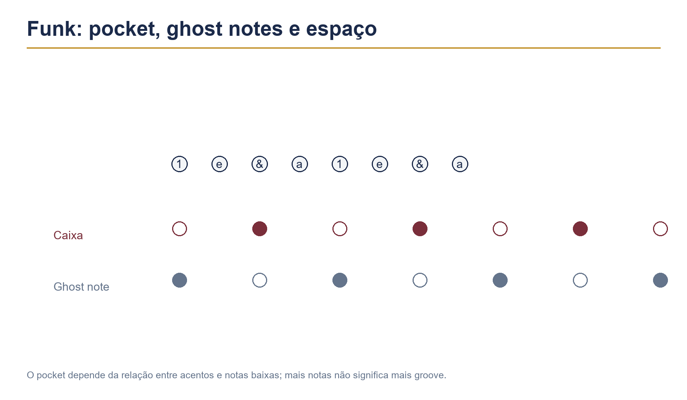

# Capítulo 30 — Funk, soul e R&B



## Objetivos de aprendizagem

Ao concluir este capítulo, você será capaz de:

- manter uma grade de semicolcheias com clareza;
- usar ghost notes e acentos sem perder o pocket;
- criar espaço entre ataques e respostas;
- alinhar bumbo, caixa e baixo com intenção;
- tocar grooves lineares simples;
- adaptar dinâmica e densidade à voz e ao arranjo.

## Pré-requisitos

Estude os Capítulos 19, 20, 21, 22 e 29. Você deve controlar semicolcheias, ghost notes, conduções, shuffle e coordenação básica.

## A ideia central

Funk, soul e R&B exigem precisão com sensação. O groove pode ter muitas subdivisões, mas cada nota precisa ocupar um lugar claro e a relação entre bumbo, caixa, condução e baixo deve produzir um pocket estável.

Pocket não é tocar sempre exatamente no centro matemático do clique. É uma sensação de encaixe controlada, em que pequenas decisões de posição, duração e dinâmica fazem a música respirar sem perder o tempo.

## Grade e acentos

Comece falando:

```text
1 e & a 2 e & a 3 e & a 4 e & a
```

Toque chimbal em semicolcheias e acentue somente os números. Depois mova os acentos para os “e” e para os “a”.

**Andamento inicial:** 45–55 BPM.  
**Repetições:** quatro compassos por posição.  
**Critério:** a grade permanece regular enquanto a dinâmica muda.

## Groove de entrada

Use caixa nos tempos 2 e 4, bumbo nos tempos 1 e 3 e chimbal em semicolcheias acentuadas nos números.

```text
Contagem:  1 e & a 2 e & a 3 e & a 4 e & a
Chimbal:   A x x x A x x x A x x x A x x x
Caixa:                 O                   O
Bumbo:     O                   O
```

Toque oito compassos sem ghost notes. Depois acrescente uma nota baixa no “a” do 1 e do 3.

## Exercício 1 — ghost notes graduais

Faça quatro versões:

1. sem ghost notes;
2. duas notas baixas por compasso;
3. quatro notas baixas;
4. combinação escolhida por você.

**Andamento:** 50 BPM.  
**Dinâmica:** backbeat médio, ghost muito baixa.  
**Repetições:** quatro compassos por versão.  
**Foco:** o groove não fica mais rápido quando a caixa ganha notas.

Grave as quatro versões e escolha a que tem melhor equilíbrio.

## Relação com o baixo

Funk e R&B costumam depender de uma conversa forte entre bumbo e baixo. Não é preciso copiar todas as notas graves. Escolha ataques que apoiem o desenho e deixe espaço para o baixo responder.

Pratique dois compassos em que bumbo e baixo imaginário coincidem nos tempos principais. Nos dois seguintes, retire uma nota do bumbo para ouvir o espaço criado.

## Exercício 2 — bumbo e silêncio

Use a grade de semicolcheias e três padrões de bumbo:

```text
A: 1 e 3
B: 1, a do 2, 3
C: 1, & do 2, e do 4
```

Toque cada padrão por quatro compassos, mantendo a caixa e a condução. Depois escolha o padrão que deixa mais espaço para uma linha de baixo imaginária.

## Acentos da caixa

A caixa pode ter backbeat forte e notas baixas entre eles. Também pode deslocar um acento para responder à voz ou a um riff.

Toque quatro compassos com backbeat nos tempos 2 e 4. Nos quatro seguintes, antecipe um acento no “a” do 4 e retorne ao tempo 1.

**Andamento:** 50–60 BPM.  
**Critério:** a antecipação é intencional e não desorganiza o compasso.

## Grooves lineares

Em uma frase linear, apenas um membro toca por vez. Isso cria espaço e clareza:

```text
Contagem:  1 e & a 2 e & a
Membros:   D - E B - D - E - B - D - E - B
```

Use a mão direita no chimbal, a esquerda na caixa e o bumbo nos pontos indicados. Comece com quatro notas e aumente gradualmente.

## Exercício 3 — linear simples

Toque quatro notas, uma por vez, alternando caixa, chimbal e bumbo. Descanse quatro posições e repita.

**Andamento:** 40 BPM.  
**Repetições:** oito compassos.  
**Foco:** nenhum membro antecipa o seguinte.

Depois transforme a sequência em uma virada de um tempo e retorne ao groove.

## Espaço e pocket

Para estudar pocket, não tente “forçar” um atraso ou adiantamento. Toque com metrônomo, grave e compare. Pequenas diferenças naturais podem aparecer, mas a base deve permanecer estável.

Pratique com o clique nos tempos 2 e 4 e depois com clique espaçado. Se o groove continuar dançável sem o som do metrônomo, você está fortalecendo a pulsação interna.

## Exercício 4 — três densidades

Toque a mesma base em três versões:

1. groove econômico;
2. groove com ghost notes;
3. groove com semicolcheias e uma variação de bumbo.

**Andamento:** 60 BPM.  
**Repetições:** oito compassos por versão.  
**Foco:** escolher a densidade conforme a seção e não como demonstração técnica.

## Soul e espaço melódico

Em soul, a bateria pode sustentar um groove profundo sem preencher todas as subdivisões. Escute o fraseado da voz e responda com mudanças pequenas de dinâmica, condução e bumbo.

Use uma base vocal e toque apenas um groove simples. Depois acrescente uma ghost note somente no final de frases vocais. Compare se a resposta ajuda ou interrompe.

## R&B e produção

R&B pode usar sons curtos, camadas eletrônicas, cortes e padrões precisos. Mesmo quando o arranjo é quantizado, o baterista precisa manter intenção de dinâmica e timbre.

Pratique um padrão em uma bateria eletrônica e depois em uma acústica. Observe como a mesma posição muda de acordo com o rebote e a projeção.

## Aplicação musical

Escolha uma base de funk, soul ou R&B sem bateria. Faça três tomadas:

1. groove simples;
2. ghost notes e acentos;
3. groove linear com uma virada curta.

Na escuta, avalie o baixo, a voz, o espaço e a consistência. Não escolha automaticamente a tomada com mais notas.

## Erros comuns e correções

### Tocar todas as semicolcheias forte

Reduza a altura das notas internas e acentue somente as posições necessárias.

### Encher o espaço da voz

Retire ghost notes e viradas durante frases importantes. A bateria pode responder entre as frases.

### Confundir pocket com atraso excessivo

Use metrônomo e gravação para verificar estabilidade. Não force uma posição que comprometa o pulso.

### Copiar o baixo inteiro

Escolha os ataques principais e deixe espaço para o instrumento grave completar o desenho.

### Fazer groove linear sem forma

Defina início, repetição e chegada. Uma sequência linear precisa participar do arranjo.

## Diagnóstico rápido

Grave oito compassos e responda:

- o backbeat é claro?
- as ghost notes estão abaixo dele?
- o bumbo deixa espaço para o baixo?
- a condução tem acentos organizados?
- o groove continua firme em volume baixo?

## Desafio de consolidação

Crie um arranjo de 24 compassos:

1. oito de groove econômico;
2. oito com ghost notes e acentos;
3. sete com groove linear ou variação de bumbo;
4. um compasso de virada e retorno.

Grave uma versão com poucas notas e outra mais densa. Escolha a que oferece melhor pocket.

## Checklist de domínio

- [ ] Mantenho semicolcheias regulares.
- [ ] Controlo acentos na condução.
- [ ] Uso ghost notes sem encobrir o backbeat.
- [ ] Relaciono bumbo e baixo.
- [ ] Consigo tocar groove linear simples.
- [ ] Deixo espaço para voz e outros instrumentos.
- [ ] Adapto densidade por seção.
- [ ] Avalio pocket por gravação e escuta.

## Rotina recomendada

Para uma sessão de 20 minutos:

- 4 minutos de grade e acentos;
- 4 minutos de ghost notes;
- 4 minutos de padrões de bumbo;
- 3 minutos de groove linear;
- 3 minutos de aplicação em base;
- 2 minutos de escuta e registro.

Funk, soul e R&B ensinam que precisão e sensação não são opostas. A nota certa, no volume certo e no espaço certo pode valer mais do que uma sequência inteira de ataques.
