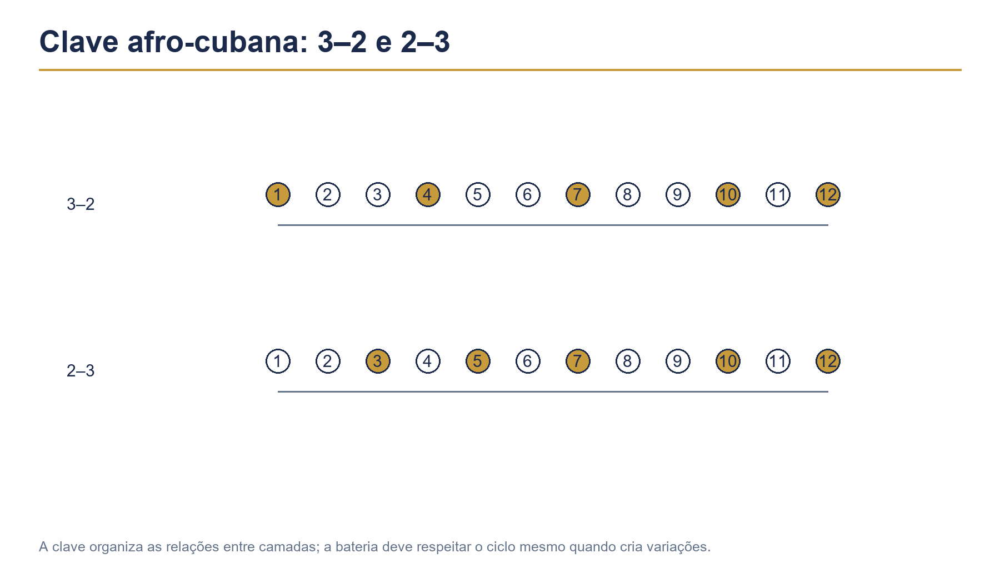

# Capítulo 34 — Latin, afro-cubano e fusões



Os ritmos latino-americanos e afro-cubanos são organizados por relações entre camadas. A bateria precisa entender a clave, sustentar o movimento e conversar com congas, bongôs, timbales, piano e baixo. O objetivo não é imitar todos os instrumentos, mas assumir uma função clara dentro do conjunto.

## Objetivos

Ao terminar este capítulo, você deverá ser capaz de:

- reconhecer a clave de son em 3–2 e 2–3;
- tocar uma marcha básica de salsa e uma cascara simples;
- coordenar bumbo, caixa, ride e hi-hat sem apagar a clave;
- aplicar padrões de bossa nova e samba-jazz à bateria;
- criar variações de mambo, cha-cha-cha e latin rock;
- combinar células afro-cubanas com linguagem de jazz, funk e rock.

## Pré-requisitos

Revise os Capítulos 11, 12, 19, 20, 21, 22, 25, 26, 30 e 33. Pratique contando em voz alta antes de tocar. A clave deve ser compreendida como estrutura, não como uma sequência de golpes decorada.

## 1. A clave como mapa

A clave de son pode ser organizada em 3–2 ou 2–3. Em dois compassos de 2/2, uma representação simplificada é:

```text
3–2:  X . . X . | . . X . X .
2–3:  . . X . X . | X . . X .
```

As posições exatas dependem da subdivisão e do estilo. Para começar, fale “um, dois, três” no primeiro compasso e “um, dois” no segundo, sentindo os pontos de apoio.

### Exercício 1 — Clave falada

1. Marque quatro pulsos regulares com o pé.
2. Fale a clave sem tocar.
3. Toque a clave na caixa ou no aro.
4. Retire a caixa e continue cantando.
5. Volte a tocar sem perder o ciclo de dois compassos.

O exercício está correto quando o silêncio entre os golpes mantém a organização interna.

## 2. Marcha básica de salsa

Uma aproximação inicial para a bateria é usar o chimbal ou ride em pulsos regulares, caixa como resposta e bumbo em pontos de sustentação. Toque de forma leve, deixando espaço para o baixo e o piano.

```text
Contagem:  1 & 2 & 3 & 4 &
Ride:      x . x . x . x .
Caixa:     . S . . . S . .
Bumbo:     B . . B . . B .
```

Não trate esse exemplo como uma fórmula definitiva. Ele serve para organizar o corpo antes de ouvir a marcha executada por uma formação completa.

### Exercício 2 — Marcha em três camadas

- toque o ride por oito compassos;
- acrescente o bumbo por mais oito;
- acrescente a caixa sem aumentar o volume;
- faça uma pausa de um compasso a cada quatro.

Quando a pausa chegar, mantenha a clave mentalmente e retorne no tempo 1.

## 3. Cascara

A cascara é uma célula de condução frequentemente associada ao aro ou à lateral do timbal. Na bateria, ela pode ser distribuída entre ride, cúpula e aro.

```text
Contagem:  1 e & a 2 e & a
Cascara:   X . X X . X . X
```

Toque a célula com a mão direita no ride e mantenha o braço relaxado. Em seguida, acrescente o bumbo apenas nos pontos em que ele não competir com a articulação principal.

## 4. Clave 3–2 e 2–3

Escolha uma única orientação por sessão. Conte dois compassos e marque os golpes da clave no aro. Depois toque a cascara com uma mão e a clave com a outra, em dinâmica baixa.

### Exercício 3 — Troca de orientação

1. Toque 16 compassos em 3–2.
2. Faça uma virada de dois tempos.
3. Toque 16 compassos em 2–3.
4. Retorne à orientação inicial sem interromper o pulso.

A mudança deve ser anunciada pela forma, não por uma aceleração. Se você se perder, pare de tocar e fale a clave durante dois ciclos.

## 5. Mambo e acentos

O mambo pode usar acentos fortes no conjunto e frases de resposta da bateria. Em uma adaptação inicial, mantenha uma condução constante e use a caixa ou os toms para responder à seção de metais.

```text
Contagem:  1 & 2 & 3 & 4 &
Ride:      x . x . x . x .
Caixa:     . . S . . S . .
Bumbo:     B . . . . B . .
```

Toque quatro compassos de acompanhamento e quatro compassos de resposta. A resposta deve ser curta, com retorno claro ao tempo 1.

## 6. Cha-cha-cha

O cha-cha-cha pede leveza, repetição e organização. Estude primeiro a condução em colcheias e acrescente o bumbo como apoio, evitando fazer um padrão de rock.

```text
Contagem:  1 & 2 & 3 & 4 &
Chimbal:   x x x x x x x x
Caixa:     . . . S . . S .
Bumbo:     B . . . B . . .
```

Reduza o volume da caixa e mantenha os movimentos próximos à pele. A estabilidade é mais importante que a força.

## 7. Bossa nova

Na bossa nova, a bateria sustenta a subdivisão com discrição. O chimbal pode marcar a pulsação, o aro pode articular a clave e o bumbo deve se relacionar com o baixo.

```text
Contagem:  1 e & a 2 e & a
Chimbal:   x . x . x . x .
Aro:       . . R . . R . .
Bumbo:     B . . . . B . .
```

Toque em 70 BPM e imagine uma linha de violão sincopada. Não preencha as síncopes com notas adicionais; deixe que elas sejam ouvidas.

## 8. Samba-jazz e latin jazz

O samba-jazz mistura a fluidez brasileira com condução de jazz, acentos e interação. Use o ride para sustentar a pulsação, o chimbal no pé para marcar 2 e 4 e o bumbo com leveza.

```text
Ride:      x . x x x . x x
Hi-hat pé: . . H . . . H .
Caixa:     . g S . . g S .
Bumbo:     B . . B . . B .
```

As ghost notes devem ser discretas. Se o groove soar como funk comum, retire notas e escute novamente o balanço da condução.

## 9. Latin rock

O latin rock combina a força do rock com células de clave e acentos afro-cubanos. O bumbo pode ser mais presente, mas a caixa deve continuar respeitando o desenho escolhido.

```text
Contagem:  1 & 2 & 3 & 4 &
Ride:      x x x x x x x x
Caixa:     . . S . . S . .
Bumbo:     B . B . B . . B
```

Acrescente uma nota de aro em uma das antecipações e compare as duas versões. A mudança precisa acrescentar caráter, não apenas densidade.

## 10. Coordenação com o pé esquerdo

O hi-hat com o pé pode marcar 2 e 4, alternar com uma célula de clave ou criar uma camada de controle. Comece sem as mãos e mantenha o pé esquerdo regular.

### Exercício 4 — Pé independente

1. Marque 2 e 4 com o hi-hat do pé.
2. Toque o ride em semínimas.
3. Acrescente a caixa no tempo 3.
4. Insira o bumbo em três pontos escolhidos.
5. Retire o ride e verifique se o ciclo continua.

O pé esquerdo não deve subir de volume quando as mãos entram. Reduza a amplitude se houver tensão.

## 11. Timbres e distribuição pela bateria

Uma mesma célula pode ser orquestrada de diferentes formas:

- aro para uma textura seca e discreta;
- caixa para uma resposta mais presente;
- tom agudo para frase de metais;
- cúpula do ride para abrir o refrão;
- chimbal fechado para manter o espaço.

Escolha o timbre pela função da seção. Não use todos os tambores no primeiro compasso apenas para demonstrar variedade.

## 12. Viradas sobre a clave

A virada não deve apagar a estrutura. Conte a clave mentalmente e faça uma frase que termine antes do novo ciclo.

### Exercício 5 — Resposta de quatro tempos

Toque três compassos de marcha e responda no quarto compasso com uma frase de quatro semicolcheias. Repita a mesma resposta em caixa, tom e combinação de caixa com bumbo.

Depois, mantenha a mesma frase e altere apenas a dinâmica. Assim você aprende a desenvolver vocabulário sem perder a identidade rítmica.

## 13. Fusões com funk e jazz

Uma fusão funciona quando as camadas têm uma hierarquia. Escolha uma estrutura principal e adicione apenas uma característica de outro estilo.

Exemplos:

- salsa com condução de jazz;
- bossa com ghost notes de funk;
- samba-jazz com frase de metais em toms;
- latin rock com acentos de clave no ride.

Faça uma versão simples e outra mais densa. Compare se a segunda realmente comunica algo novo ou apenas ficou mais cheia.

## 14. Estudo com metrônomo

Pratique cada célula em 60, 80 e 100 BPM. Nos dois primeiros andamentos, conte em voz alta. Em 100 BPM, reduza a amplitude e mantenha o mesmo balanço.

Use o metrônomo de três maneiras:

1. em todos os tempos, para organizar o corpo;
2. nos tempos 2 e 4, para testar o balanço;
3. em um pulso por compasso, para testar a forma.

Grave sempre oito compassos. A estabilidade deve ser avaliada pelo áudio, não apenas pela sensação corporal.

## 15. Aplicação em arranjo

Monte um arranjo de 32 compassos:

- 8 de bossa nova;
- 8 de cha-cha-cha;
- 8 de latin rock;
- 8 de samba-jazz.

Use uma introdução de dois compassos e uma virada curta para cada mudança. Escolha uma orientação de clave e mantenha-a durante todo o arranjo, salvo se a música pedir uma alteração explícita.

## Erros comuns

### Ignorar a clave

O groove pode parecer regular, mas não tem direção. Pare e fale a clave durante quatro ciclos antes de retomar.

### Tocar tudo com a mesma dinâmica

O conjunto fica sem hierarquia. Defina qual camada é principal e reduza as demais.

### Fazer viradas longas

A estrutura desaparece. Use frases de dois ou quatro tempos e retorne claramente ao novo ciclo.

### Copiar a clave na caixa com excesso de volume

A bateria passa a competir com a percussão. Toque no aro ou use ghost notes mais baixas.

### Misturar estilos sem uma base

O resultado parece aleatório. Escolha um estilo principal e apenas uma característica secundária.

## Diagnóstico

Marque de 0 a 2:

| Critério | 0 | 1 | 2 |
|---|---|---|---|
| Clave | perdida | parcialmente estável | internalizada |
| Pulso | oscila | mantém trechos | constante |
| Coordenação | tensa | recupera com esforço | relaxada |
| Dinâmica | sem hierarquia | parcialmente controlada | clara |
| Espaço | congestionado | irregular | musical |
| Forma | perde mudanças | acompanha com hesitação | segura |

Pontuação mínima recomendada: 9 de 12. Abaixo disso, volte à clave falada e ao padrão de duas camadas.

## Desafio do capítulo

Escolha uma orientação de clave e crie um groove de 16 compassos. A primeira metade deve ser econômica; a segunda deve incluir uma variação de condução e uma virada de dois tempos. Grave a versão em 80 BPM e depois em 100 BPM.

Escreva uma breve avaliação: o que mudou na articulação, onde a clave ficou mais difícil e qual camada deve ser simplificada.

## Checklist

- [ ] Consigo cantar e marcar a clave 3–2 e 2–3.
- [ ] Toco uma marcha básica sem perder o espaço.
- [ ] Reconheço a função da cascara.
- [ ] Pratico cha-cha-cha e bossa com dinâmica econômica.
- [ ] Coordeno bumbo, caixa, condução e hi-hat do pé.
- [ ] Faço viradas que respeitam o ciclo da clave.
- [ ] Crio uma fusão com hierarquia clara.
- [ ] Gravei o desafio em dois andamentos.

## Rotina sugerida

| Etapa | Tempo | Foco |
|---|---:|---|
| Clave falada | 5 min | mapa interno |
| Marcha e cascara | 10 min | coordenação |
| Bossa ou cha-cha-cha | 8 min | espaço e leveza |
| Latin rock | 8 min | força controlada |
| Samba-jazz | 8 min | interação e condução |
| Viradas e gravação | 8 min | aplicação e forma |

Encerre anotando qual camada sustentou melhor o estilo e qual movimento precisa ser reduzido para tocar com mais precisão.
