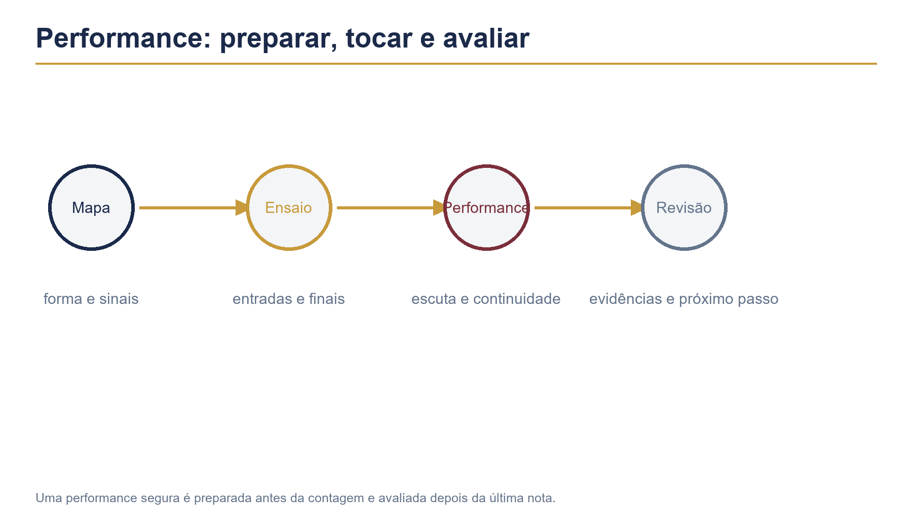

# Capítulo 39 — Performance, repertório e preparação para tocar



Uma boa performance começa antes da contagem. O baterista prepara o repertório, entende a forma, testa o equipamento, combina sinais e cria estratégias para continuar quando algo sai diferente do ensaio. Técnica e musicalidade precisam aparecer juntas.

## Objetivos

Ao terminar este capítulo, você deverá ser capaz de:

- organizar um repertório com segurança;
- preparar partes, mapas e contagens;
- ensaiar entradas, finais, viradas e transições;
- tocar com diferentes formações e níveis de monitoramento;
- lidar com erros sem interromper a música;
- avaliar uma performance com critérios objetivos;
- criar uma rotina de preparação física e mental.

## Pré-requisitos

Revise os Capítulos 26, 27, 35, 36, 37 e 38. Tenha pelo menos três músicas ou arranjos para trabalhar. O repertório pode ser simples; o foco é desenvolver consistência e presença musical.

## 1. Conhecer o repertório

Para cada música, registre:

- título e andamento;
- tonalidade, se relevante para as entradas;
- contagem inicial;
- forma completa;
- padrão principal de cada seção;
- viradas importantes;
- cortes, pausas e final;
- sinais combinados com a banda.

Não memorize apenas os compassos. Memorize a função de cada seção e o que muda quando a música avança.

## 2. Mapa de música

Use um mapa compacto:

```text
Intro 4 — verso 8 — refrão 8 — verso 8 — refrão 8 — ponte 8 — final 4
```

Ao lado de cada seção, escreva uma palavra de intenção:

```text
intro: expectativa
verso: controle
refrão: abertura
ponte: espaço
final: direção
```

Essas palavras ajudam a interpretar a forma sem olhar para cada nota.

## 3. Preparação de contagem

Combine quem conta a música e quantos tempos serão dados. A contagem deve comunicar andamento e caráter.

Pratique três possibilidades:

- quatro tempos antes da entrada;
- dois compassos de condução;
- entrada direta com pickup ou virada.

Grave a contagem e confira se ela deixa claro o primeiro tempo. Uma contagem confusa gera insegurança antes mesmo de a música começar.

## 4. Ensaio por seções

Divida o ensaio em quatro etapas:

1. entradas e primeiros compassos;
2. transições entre seções;
3. finais e cortes;
4. execução completa sem interrupção.

Não repita a música inteira dez vezes ignorando o final. O começo e o final merecem o mesmo cuidado que o groove principal.

### Exercício 1 — Entradas e finais

Escolha três músicas. Pratique apenas:

- contar e entrar;
- tocar quatro compassos;
- parar no final combinado.

Repita sem olhar para as anotações. Depois alterne a ordem das músicas para testar a memória da forma.

## 5. Repertório em blocos

Organize o repertório em blocos de energia:

- abertura;
- desenvolvimento;
- pico;
- encerramento.

Evite colocar todas as músicas mais rápidas em sequência se isso comprometer sua resistência. Planeje também água, afinação, troca de baqueta e pequenas pausas.

## 6. Comunicação com a banda

Combine sinais simples:

- olhar para indicar uma virada;
- aceno para repetir uma seção;
- gesto para cortar;
- indicação de dinâmica;
- contagem para reiniciar.

Não dependa de sinais improvisados em uma passagem difícil. Teste-os no ensaio e escolha um gesto que possa ser visto de onde você toca.

## 7. Viradas de performance

Uma virada de apresentação precisa preparar o próximo evento. Antes de escolher a frase, saiba se ela anuncia:

- refrão;
- volta do verso;
- pausa da banda;
- final;
- mudança de andamento.

### Exercício 2 — Três respostas para a mesma transição

Crie uma virada curta, média e longa para a passagem verso–refrão. Toque cada uma em quatro ensaios diferentes. Escolha a mais segura e a que comunica melhor a mudança.

Segurança não significa tocar sempre a frase mais simples; significa escolher uma frase que você controla no contexto.

## 8. Tocar com clique

Algumas performances usam metrônomo no ouvido. Pratique com clique e sem clique, mantendo o mesmo andamento. Quando houver clique, não deixe que ele substitua a escuta da banda.

Treine o clique em:

1. todos os tempos;
2. 2 e 4;
3. um pulso por compasso;
4. apenas nas entradas de seção.

O silêncio entre cliques deve continuar organizado.

## 9. Monitoramento e escuta

Se não ouvir o próprio instrumento, peça ajustes objetivos:

- mais caixa;
- mais bumbo;
- mais voz ou baixo;
- menos prato;
- retorno de uma seção específica.

Não aumente tudo ao mesmo tempo. Um monitor muito alto dificulta a dinâmica e aumenta a fadiga.

## 10. Equipamento e conferência

Antes de tocar, confira:

- banco e altura;
- pedal e corrente;
- parafusos e estantes;
- peles e afinação;
- baquetas extras;
- cabos e microfones;
- fones, se houver clique;
- água e iluminação da partitura.

Faça um teste de cada peça em volume baixo e médio. O objetivo é evitar que uma falha mecânica apareça no meio da música.

## 11. Estratégia para erros

Quando errar uma nota, continue. Quando perder um compasso, procure a próxima referência: baixo, voz, condução, mudança de seção ou contagem.

Use três prioridades:

1. voltar ao pulso;
2. encontrar a forma;
3. retomar a dinâmica.

Não tente recuperar todas as notas perdidas. Uma entrada segura no próximo compasso vale mais que uma correção apressada.

## 12. Mudança de andamento

Se a banda acelerar, não persiga cada golpe. Reestabeleça o pulso interno, simplifique a condução e espere a próxima referência. Se a banda desacelerar, evite empurrar o andamento sozinho.

Pratique com gravações que apresentam pequenas variações. Isso prepara você para situações reais sem abandonar a responsabilidade de manter o tempo.

## 13. Dinâmica ao vivo

Palco e sala podem fazer você tocar mais forte que o necessário. Use o refrão para abrir, mas preserve espaço no verso. Se tudo estiver forte, nada parecerá grande.

Faça uma gravação distante do ensaio. O som percebido do banco não é igual ao som percebido pelo público.

## 14. Repertório memorizado e partitura

Mesmo quando a música está memorizada, uma folha com o mapa pode aumentar a segurança. Use marcações discretas e evite depender de ler cada nota durante a performance.

Para repertório novo, escreva apenas informações úteis:

```text
intro 4 | verso 8 | parada no & de 4 | refrão 8 | final seco
```

## 15. Ensaio sem parar

Faça uma passagem completa como se fosse apresentação. Não interrompa por erros pequenos. Depois anote os pontos a corrigir.

### Exercício 3 — Simulação de show

1. organize três músicas em sequência;
2. faça uma contagem de abertura;
3. execute sem parar;
4. faça uma transição curta entre músicas;
5. finalize com o corte combinado;
6. espere cinco minutos antes de avaliar a gravação.

O intervalo reduz a sensação de urgência e permite ouvir com mais objetividade.

## 16. Presença e postura

Presença não é exagero de movimento. É tocar com corpo alinhado, olhar atento, respiração regular e intenção clara. Movimentos grandes só devem aparecer quando ajudam a comunicação ou a técnica.

Antes da contagem:

- solte ombros e mandíbula;
- apoie os pés;
- respire de forma lenta;
- visualize o primeiro compasso;
- confirme a baqueta e o banco.

## 17. Pós-performance

Depois de tocar, não avalie apenas “foi bom” ou “foi ruim”. Registre:

- o que ficou estável;
- onde a forma gerou dúvida;
- qual seção precisou de mais energia;
- como o monitoramento afetou a execução;
- o que será ajustado no próximo ensaio.

Separe problemas técnicos, musicais e de preparação. Cada categoria pede uma solução diferente.

## 18. Portfólio de repertório

Mantenha uma lista com:

```text
Música | BPM | nível de segurança | pontos de atenção | última revisão
```

Classifique cada música:

- A: pronta para tocar;
- B: segura, mas requer revisão;
- C: em construção.

Revise músicas A para não perder familiaridade e escolha poucas músicas C por vez.

## Erros comuns

### Ensaiar apenas o groove principal

Entradas, transições e finais ficam frágeis. Trabalhe a forma completa.

### Tocar mais forte no palco

A dinâmica desaparece. Faça gravações de fora e combine referências de volume.

### Parar por uma nota errada

A música perde continuidade. Pratique simulações sem interrupção.

### Não combinar sinais

Cada músico entende a forma de um jeito. Defina entradas, cortes e repetições antes do show.

### Confiar apenas na memória

Uma folha com mapa reduz a carga mental e ajuda em repertório longo.

## Diagnóstico

Marque de 0 a 2:

| Critério | 0 | 1 | 2 |
|---|---|---|---|
| Repertório | desconhecido | parcialmente seguro | dominado |
| Forma | perde seções | acompanha com hesitação | clara |
| Entradas | inseguras | funcionam com preparação | consistentes |
| Finais | indefinidos | recupera | precisos |
| Escuta | depende do próprio som | ajusta durante a execução | ouve o conjunto |
| Continuidade | para com erros | simplifica às vezes | segue musicalmente |

Pontuação mínima recomendada: 9 de 12. Abaixo disso, reduza o repertório e simule uma música por vez.

## Desafio do capítulo

Monte um mini-repertório de três músicas. Prepare os mapas, defina os sinais, confira o equipamento e faça uma simulação sem parar. Grave áudio ou vídeo de fora da bateria.

Depois responda:

1. Qual foi a entrada mais segura?
2. Qual transição precisa ser ensaiada novamente?
3. Onde a dinâmica perdeu contraste?
4. Qual solução será aplicada no próximo ensaio?

## Checklist

- [ ] Tenho um mapa de cada música.
- [ ] Sei as entradas, transições e finais.
- [ ] Combinei sinais com os outros músicos.
- [ ] Consigo tocar com clique e sem clique.
- [ ] Sei lidar com erros sem interromper.
- [ ] Confiro banco, pedais, estantes, baquetas e retorno.
- [ ] Faço gravações de simulação.
- [ ] Registro ajustes depois de cada performance.

## Rotina sugerida

| Etapa | Tempo | Foco |
|---|---:|---|
| Alongamento e respiração | 5 min | preparação |
| Entradas e finais | 8 min | segurança |
| Transições | 10 min | forma |
| Música completa | 12 min | continuidade |
| Simulação de repertório | 15 min | performance |
| Avaliação | 5 min | ajustes |

Encerre anotando uma decisão de preparação e uma decisão musical para a próxima apresentação.
