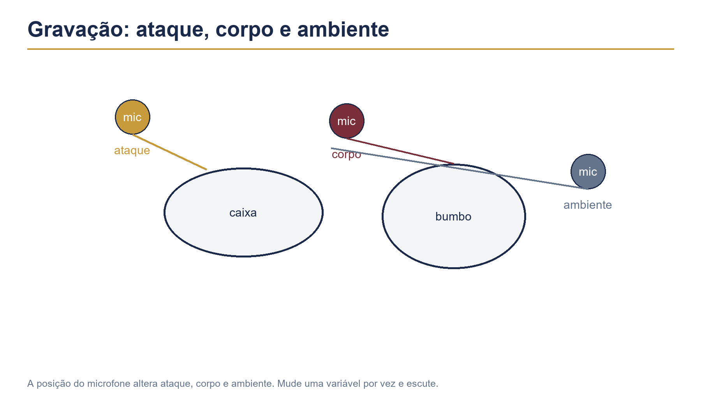
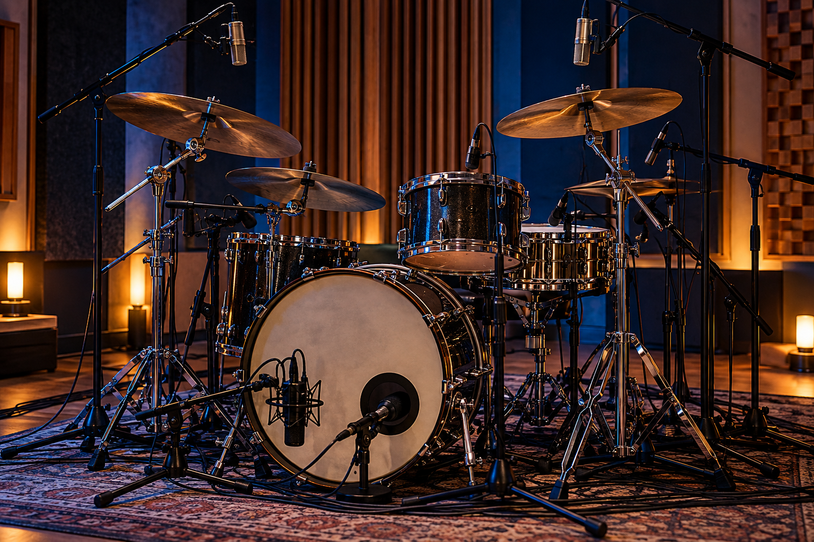

# Capítulo 40 — Gravação, produção e trabalho em estúdio




Gravar bateria é transformar uma performance em material que poderá ser ouvido muitas vezes. O estúdio revela estabilidade, dinâmica, ruídos, escolhas de timbre e relação com o clique. Uma boa sessão depende de preparação musical, técnica e comunicação.

## Objetivos

Ao terminar este capítulo, você deverá ser capaz de:

- preparar uma música para gravação;
- tocar com clique e referência de guia;
- organizar takes e marcações;
- compreender funções básicas de microfones e vazamentos;
- comunicar problemas ao produtor ou técnico;
- avaliar timing, dinâmica, timbre e forma;
- escolher entre correção, nova tomada e simplificação.

## Pré-requisitos

Revise os Capítulos 12, 25, 26, 27, 35, 37 e 39. Tenha uma música bem ensaiada, um metrônomo e um dispositivo de gravação. O objetivo é simular o processo antes de depender de um estúdio profissional.

## 1. Preparar a música

Antes da sessão, defina:

- andamento e possíveis mudanças;
- contagem de entrada;
- mapa de forma;
- padrões de cada seção;
- viradas importantes;
- final e cortes;
- timbre desejado;
- número de takes planejado.

Não deixe uma decisão estrutural importante para o momento em que o botão de gravação já estiver ligado.

## 2. Guia e clique

O clique organiza o tempo, mas a música precisa continuar respirando. Pratique com uma guia simples de harmonia e voz para sentir entradas e dinâmica.

Use três níveis de estudo:

1. metrônomo sozinho;
2. metrônomo com guia;
3. guia sem metrônomo, mantendo o andamento aprendido.

Depois volte ao clique. Se a execução mudar muito entre os três níveis, o pulso interno ainda precisa de trabalho.

## 3. Contagem e primeiro compasso

O primeiro compasso define o caráter da faixa. Teste contagens diferentes:

- quatro cliques secos;
- dois compassos de condução;
- uma virada curta;
- entrada após uma anacruse da guia.

Escolha a opção que ajude todos os músicos a entrar juntos. Grave uma prévia e confira se o primeiro acento chega naturalmente.

## 4. Preparação da bateria

Uma bateria bem regulada facilita a gravação. Confira:

- afinação coerente entre tambores;
- pele sem ruído indesejado;
- estantes firmes;
- pedais silenciosos;
- banco estável;
- posição que permita repetir o movimento;
- baquetas de reserva.

Teste o instrumento em diferentes volumes. Um tom que parece equilibrado sozinho pode desaparecer ao lado do baixo e das guitarras.

## 5. Microfonação: noções essenciais

Cada microfone capta uma parte do som e também recebe vazamento das outras peças. A posição altera ataque, corpo e quantidade de ambiente.

Pense em três funções:

- ataque: definição do golpe;
- corpo: peso e sustentação;
- ambiente: espaço e profundidade.

Não mova um microfone sem ouvir a consequência. Pequenas mudanças de posição podem alterar muito o equilíbrio.

## 6. Fase e vazamento

Quando dois microfones captam a mesma peça em posições diferentes, o som pode ficar fino ou perder graves se as ondas se combinarem de forma desfavorável. O técnico deve verificar fase e distância.

Como músico, ajude mantendo a posição do banco e da bateria durante a sessão. Alterar muito a altura ou a distância dos tambores modifica o equilíbrio captado.

## 7. Tocar para o microfone

Não toque “dentro” do microfone. Toque no instrumento com a técnica e a dinâmica necessárias. Um golpe mais forte nem sempre resulta em som melhor; pode apenas gerar distorção ou excesso de ataque.

Faça uma tomada de teste e escute:

- caixa presente, mas não agressiva;
- bumbo definido, sem ocupar tudo;
- pratos controlados;
- toms afinados e claros;
- ambiente coerente com o estilo.

## 8. Takes completos

Comece com uma tomada completa, mesmo que existam erros pequenos. Ela mostra a energia, a forma e a resistência reais da performance.

Depois classifique:

- take de referência: melhor visão geral;
- take técnico: melhor precisão;
- take expressivo: melhor dinâmica;
- take de segurança: alternativa para edição.

Uma tomada perfeita em pequenos trechos pode não ter a mesma musicalidade de uma execução completa.

### Exercício 1 — Três takes

Grave a mesma música três vezes sem parar. Descanse entre takes e anote:

1. onde o tempo ficou mais estável;
2. onde a energia caiu;
3. qual virada funcionou melhor;
4. qual take você escolheria como base.

## 9. Punch-in e gravação por partes

Se uma seção precisa ser refeita, saiba exatamente onde entrar e sair. Conte pelo menos um compasso antes e depois da área corrigida.

Pratique o punch-in em casa:

1. toque uma música inteira;
2. marque um compasso problemático;
3. continue até a seção seguinte;
4. repita somente o trecho, entrando no compasso anterior;
5. retorne sem mudar o timbre ou a dinâmica.

A emenda só funciona se o corpo e o som estiverem preparados para a transição.

## 10. Timing

Timing não é deixar todas as notas matematicamente idênticas. É decidir se uma parte deve ser adiantada, atrasada ou exatamente alinhada ao estilo e à banda.

Avalie:

- início e fim de cada seção;
- relação entre bumbo e baixo;
- backbeat da caixa;
- consistência da condução;
- viradas e retornos.

Uma execução pode ter pequenas variações naturais e ainda soar firme. O problema é a variação sem intenção.

## 11. Dinâmica na gravação

O estúdio evidencia quando o refrão não abre ou quando o verso já começa no máximo. Planeje uma curva de energia:

```text
intro: baixo
verso: contido
pré-refrão: crescimento
refrão: aberto
ponte: contraste
final: direção
```

Faça uma tomada pensando apenas na dinâmica. Depois faça outra pensando na precisão. Compare e combine as melhores decisões.

## 12. Escolha de timbres

O estilo define a escolha. Teste:

- caixa seca e caixa aberta;
- chimbal fechado e mais aberto;
- ride com borda e cúpula;
- toms graves ou mais definidos;
- bumbo com ataque curto ou sustentado.

Não mude muitos elementos ao mesmo tempo. Compare uma alteração por vez e anote o resultado.

## 13. Comunicação com o produtor

Use linguagem objetiva. Em vez de “não está bom”, diga:

- “a caixa está cobrindo a voz”;
- “o bumbo não está definido no refrão”;
- “a virada chega antes do tempo 1”;
- “preciso de mais referência da guia no fone”;
- “o verso precisa ficar mais contido”.

Escute sugestões antes de defendê-las. O produtor pode estar ouvindo uma relação de camadas que não aparece do banco.

## 14. Gravação com fones

Um fone mal ajustado pode levar você a tocar forte ou atrasado. Peça níveis equilibrados de:

- clique;
- voz ou guia;
- baixo;
- próprio instrumento;
- referência harmônica.

Não use volume alto para compensar falta de clareza. Ajuste a mistura e descanse os ouvidos.

## 15. Edição e quantização

Edição pode corrigir um erro pontual, mas não substitui uma performance consistente. Antes de quantizar, pergunte:

- o erro realmente prejudica a música?
- a correção altera o balanço?
- o vazamento de outros microfones continua coerente?
- uma nova tomada seria mais natural?

Quantização extrema pode retirar dinâmica e interação. Use-a como ferramenta, não como solução automática.

## 16. Overdubs e camadas

Pratos, percussão, palmas ou elementos eletrônicos podem ser gravados depois. Ao adicionar uma camada, mantenha a função da bateria principal clara.

Grave um overdub apenas se ele acrescentar:

- textura;
- acento de forma;
- transição;
- contraste de seção;
- identidade de produção.

Mais uma camada não é necessariamente mais musical.

## 17. Ruídos e consistência

Observe ruídos de:

- pedal;
- banco;
- estante;
- aro;
- correntes;
- baquetas tocando no suporte;
- movimento de roupa ou cabo.

Faça uma tomada silenciosa e ouça o ambiente. Corrija a causa antes de pedir edição.

## 18. Plano de sessão

Organize uma sessão de duas horas:

1. 15 min: montagem e checagem;
2. 15 min: teste de timbres e níveis;
3. 10 min: ensaio com clique;
4. 30 min: takes completos;
5. 10 min: descanso;
6. 25 min: correções ou overdubs;
7. 10 min: tomada de segurança;
8. 5 min: anotações e organização dos arquivos.

O descanso evita que a qualidade caia justamente nas tomadas finais.

## 19. Organização dos arquivos

Nomeie cada arquivo com:

```text
artista_musica_BPM_tomada_data
```

Mantenha uma lista com:

- melhor take completo;
- melhor seção;
- problemas pendentes;
- decisões de edição;
- observações de timbre.

Uma sessão organizada economiza tempo e reduz decisões repetidas.

## 20. Avaliação final

Escute a música longe da bateria e em volume moderado. Pergunte:

- o groove sustenta a música?
- o refrão realmente abre?
- o final comunica a intenção?
- as viradas ajudam a forma?
- o som da bateria se encaixa no arranjo?
- a performance parece humana e controlada?

Faça anotações concretas para a próxima gravação.

## Erros comuns

### Gravar sem ensaiar a forma

Os takes ficam tecnicamente bons, mas a música se perde. Prepare o mapa antes de entrar no estúdio.

### Tocar mais forte por causa do fone

O som fica agressivo e a resistência cai. Ajuste o retorno em vez de aumentar a força.

### Fazer apenas takes fragmentados

Você perde energia e continuidade. Faça pelo menos uma tomada completa antes de corrigir partes.

### Quantizar tudo

O balanço desaparece. Compare a edição com o take original e preserve variações intencionais.

### Não pedir esclarecimentos

Uma dúvida de arranjo se transforma em várias tomadas perdidas. Pergunte antes de gravar.

## Diagnóstico

Marque de 0 a 2:

| Critério | 0 | 1 | 2 |
|---|---|---|---|
| Preparação | improvisada | parcial | completa |
| Clique | perde o pulso | mantém trechos | estável |
| Dinâmica | plana | parcialmente contrastante | musical |
| Timbre | inadequado | funcional | integrado |
| Comunicação | confusa | resolve depois | objetiva |
| Takes | fragmentados | alguns completos | completos e organizados |

Pontuação mínima recomendada: 9 de 12. Abaixo disso, faça uma sessão simulada antes de gravar novamente.

## Desafio do capítulo

Prepare e grave uma música completa em três takes. Antes, faça um mapa, determine o BPM, defina o timbre e organize o equipamento. Depois:

1. escolha o melhor take geral;
2. selecione uma seção que merece nova tomada;
3. avalie dinâmica, timing e forma;
4. escreva um plano de edição mínimo.

Não edite imediatamente. Primeiro aprenda a ouvir a performance inteira.

## Checklist

- [ ] Preparei mapa, BPM, entradas e finais.
- [ ] Testei clique, guia e retorno.
- [ ] Conferi a bateria e os ruídos mecânicos.
- [ ] Fiz uma tomada completa antes de corrigir partes.
- [ ] Controlei dinâmica e timbre por seção.
- [ ] Sei comunicar problemas de forma objetiva.
- [ ] Organizei nomes e observações dos arquivos.
- [ ] Avaliei a gravação longe do instrumento.

## Rotina sugerida

| Etapa | Tempo | Foco |
|---|---:|---|
| Mapa e escuta | 8 min | preparação |
| Clique e guia | 8 min | pulso |
| Teste de timbre | 8 min | som |
| Takes completos | 20 min | continuidade |
| Correção de seção | 10 min | precisão |
| Escuta e registro | 8 min | avaliação |

Encerre anotando o melhor take, o maior problema ouvido e a decisão que melhoraria a próxima sessão.
